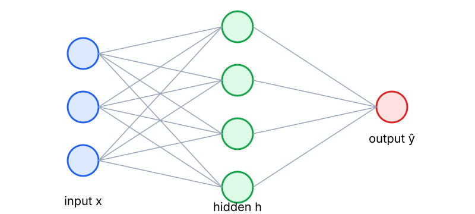

## 핵심 개념

퍼셉트론은 입력의 가중합에 활성화 함수를 적용한 단순한 모델이다.

$$
\hat y = \sigma(\mathbf{w}^\top \mathbf{x} + b)
$$

단층 퍼셉트론은 선형 분리 가능한 문제만 풀 수 있으므로(예: XOR 불가), 은닉층을 쌓은 **다층 퍼셉트론(MLP)** 을 사용한다.



## 유도: 은닉층 하나의 MLP

$$
\mathbf{h} = \phi(W_1 \mathbf{x} + \mathbf{b}_1), \qquad \hat y = W_2 \mathbf{h} + b_2
$$

$\phi$가 선형이면 두 층을 합쳐도 $W_2 W_1$ 이라는 하나의 선형 변환이 되므로, 비선형 활성화가 반드시 필요하다.

## 예시

```python
import torch
import torch.nn as nn

model = nn.Sequential(
    nn.Linear(2, 4),
    nn.ReLU(),
    nn.Linear(4, 1),
)
x = torch.tensor([[0., 0.], [0., 1.], [1., 0.], [1., 1.]])
print(model(x).shape)  # torch.Size([4, 1])
```
