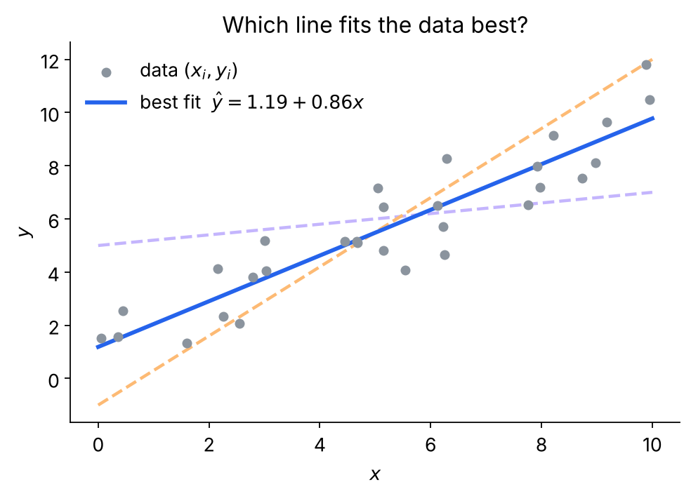
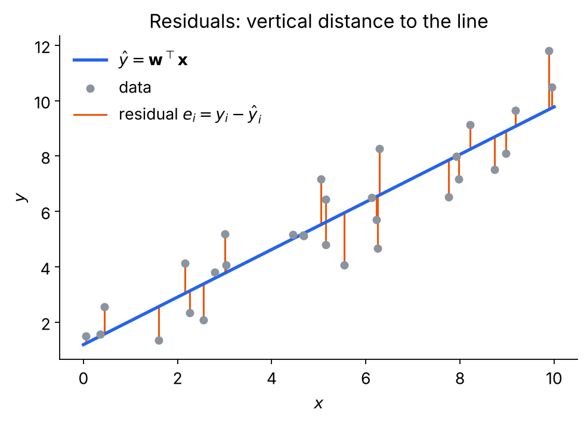
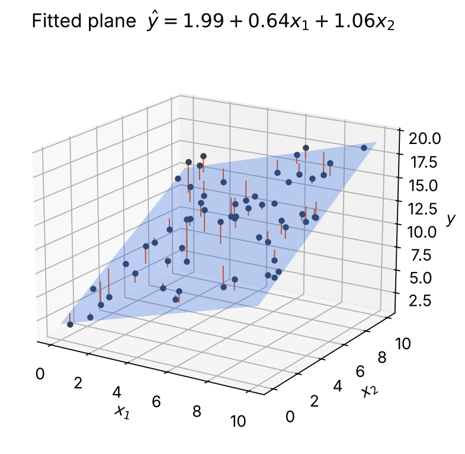
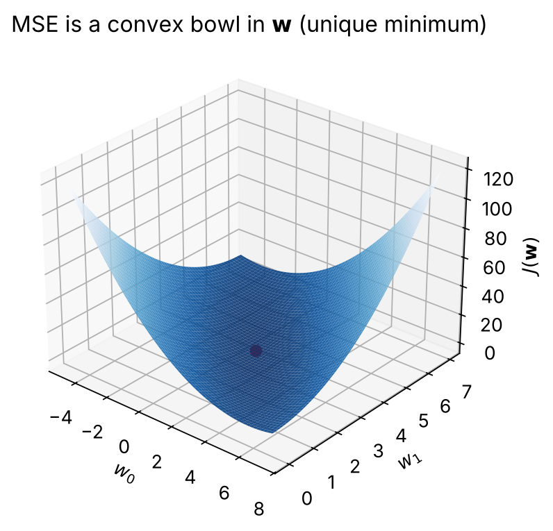
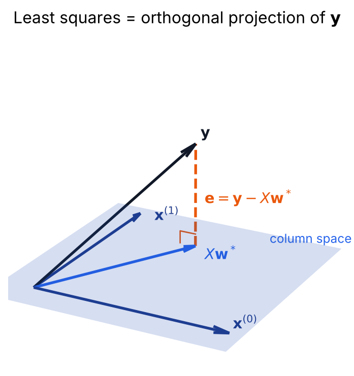
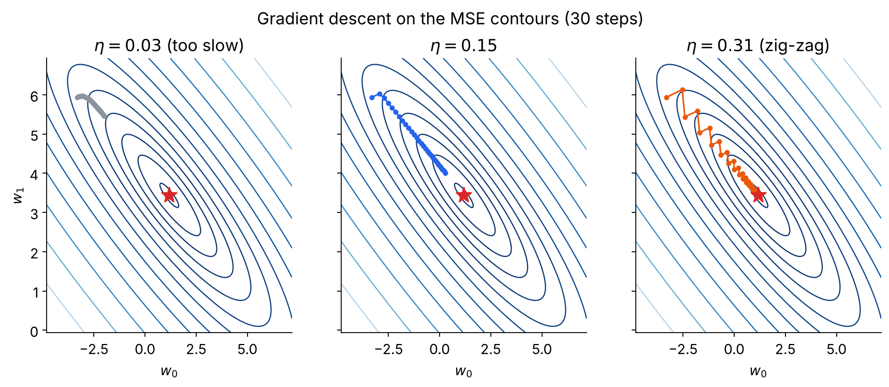
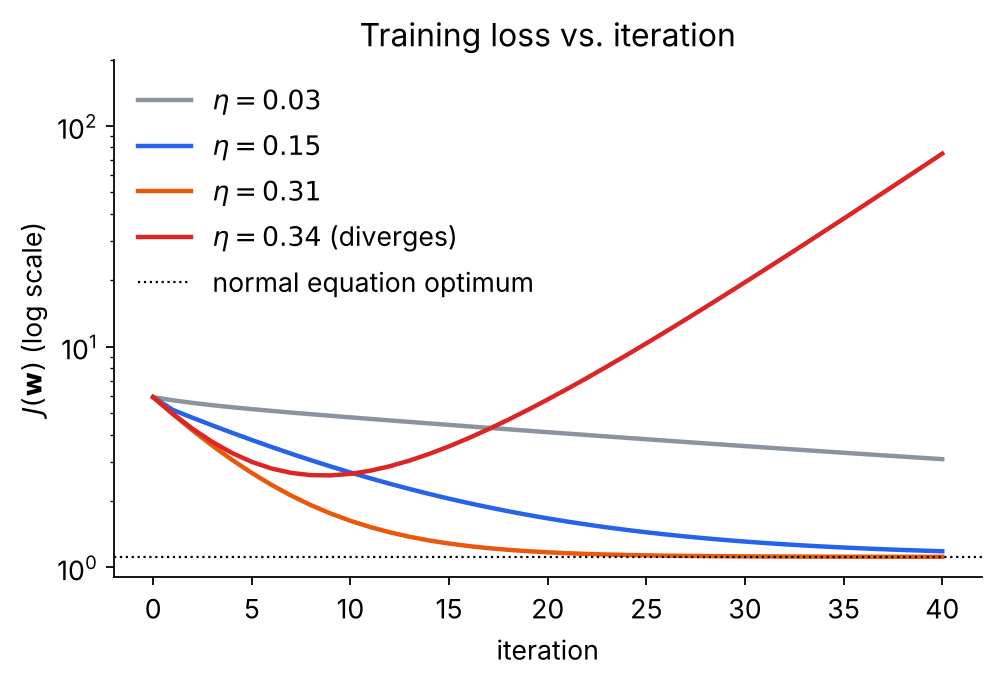

## 정의

선형 회귀(Linear Regression)는 입력 특성(feature)과 실수값 출력 사이의 관계를 **직선(또는 평면)** 으로 근사하는 모델이다. 집의 면적으로 가격을 예측하거나, 공부 시간으로 시험 점수를 예측하는 것처럼 출력이 연속적인 값일 때 가장 먼저 떠올리는 모델이 바로 선형 회귀다.

가장 단순한 경우부터 보자. 입력이 하나뿐인 데이터 $\{(x_i, y_i)\}_{i=1}^{n}$, $x_i, y_i \in \mathbb{R}$ 가 주어졌을 때, 모델은 기울기 $a$와 절편 $b$를 가진 직선이다.

$$
\hat y = f(x) = ax + b
$$

문제는 데이터 위에 그을 수 있는 직선이 무수히 많다는 것이다. 아래 그림의 점선 두 개도 나름대로 데이터를 지나가지만, 파란 실선이 "가장 잘 맞는다"는 것은 눈으로도 알 수 있다. 선형 회귀의 핵심 질문은 결국 **"가장 잘 맞는다"를 어떻게 수치로 정의하고, 그 직선을 어떻게 찾을 것인가**이다.



"잘 맞는다"를 정의하기 위해 각 데이터에 대해 실제값과 예측값의 차이, 즉 잔차(residual) $e_i = y_i - \hat y_i$ 를 생각한다. 그림에서 주황색 세로 선분이 잔차다. 잔차는 양수일 수도 음수일 수도 있어서 그대로 더하면 서로 상쇄되므로, 제곱해서 더한 값을 오차의 크기로 삼는다.



이렇게 잔차 제곱합을 최소로 만드는 직선을 고르는 방법을 최소제곱법(Least Squares)이라 하고, 이 방법으로 학습한 선형 회귀를 보통 최소제곱(Ordinary Least Squares, OLS)이라 부른다.

$$
\min_{a,\,b} \sum_{i=1}^{n} \big(y_i - (ax_i + b)\big)^2
$$

여기서 "왜 절댓값이 아니라 하필 제곱인가"라는 의문이 들 수 있다. 계산이 편하다는 실용적인 이유도 있지만, 확률적인 근거도 있다. 데이터가 $y_i = \mathbf{w}^\top \mathbf{x}_i + \epsilon_i$, $\epsilon_i \sim \mathcal{N}(0, \sigma^2)$ 처럼 참값에 정규분포 노이즈가 더해져 생성된다고 가정하고 최대우도추정(Maximum Likelihood Estimation, MLE)을 하면, 로그 우도는

$$
\log L_{\mathbf{w}} = -n\log(\sqrt{2\pi}\,\sigma) - \frac{1}{2\sigma^2}\sum_{i=1}^{n}(y_i - \mathbf{w}^\top\mathbf{x}_i)^2
$$

이 된다. 첫째 항은 $\mathbf{w}$와 무관한 상수이고 둘째 항의 계수는 양수이므로, 우도를 최대화하는 것은 정확히 잔차 제곱합을 최소화하는 것과 같다. 즉 **노이즈가 가우시안이라고 믿는다면 제곱오차가 가장 자연스러운 기준**이다. 반대로 노이즈를 라플라스 분포로 가정하면 같은 논리로 절대오차 $\sum |y_i - \mathbf{w}^\top\mathbf{x}_i|$ 를 최소화하는 모델이 나온다.

## Multiple Linear Regression

현실의 문제에서 출력에 영향을 주는 입력은 대개 여러 개다. 집값은 면적뿐 아니라 방의 수, 역까지의 거리, 연식에도 영향을 받는다. 입력이 $d$차원 벡터 $\mathbf{x}_i = (x_{i,1}, \dots, x_{i,d}) \in \mathbb{R}^d$ 로 늘어나면, 모델도 각 특성에 가중치를 곱해 더한 형태로 자연스럽게 확장된다. 이를 다중 선형 회귀(Multiple Linear Regression)라 한다.

$$
\hat y_i = w_1 x_{i,1} + w_2 x_{i,2} + \cdots + w_d x_{i,d} + b
$$

입력이 하나일 때 모델이 2차원 평면 위의 직선이었다면, 입력이 두 개일 때는 3차원 공간의 평면이 되고, 그 이상에서는 초평면(hyperplane)이 된다. 아래 그림은 두 특성 $x_1, x_2$ 로 $y$를 예측하는 모델을 학습한 결과다. 데이터 점과 평면 사이의 세로 선분이 여전히 잔차이고, 우리가 하는 일은 여전히 이 잔차들의 제곱합을 최소로 만드는 평면을 찾는 것이다.



절편 $b$를 따로 들고 다니면 식이 번거로워지므로, 흔히 쓰는 기법이 있다. 모든 입력 벡터 앞에 항상 1인 성분 $x_{i,0} = 1$ 을 덧붙이고, 절편을 $w_0 = b$ 로 가중치 벡터에 포함시키는 것이다.

$$
\mathbf{x}_i = (1, x_{i,1}, \dots, x_{i,d})^\top \in \mathbb{R}^{d+1}, \qquad \mathbf{w} = (w_0, w_1, \dots, w_d)^\top \in \mathbb{R}^{d+1}
$$

이렇게 하면 모델은 내적 하나로 깔끔하게 정리되고, 학습 문제도 다음과 같이 쓸 수 있다.

$$
\hat y_i = \mathbf{w}^\top \mathbf{x}_i, \qquad \min_{\mathbf{w}} \sum_{i=1}^{n} (y_i - \mathbf{w}^\top \mathbf{x}_i)^2
$$

### Matrix Form

데이터가 $n$개면 위의 식은 사실 $n$개의 예측을 한꺼번에 하는 것이다. 이를 행렬로 묶으면 식이 훨씬 간결해지고, 뒤에서 미분할 때도 큰 힘을 발휘한다. 각 데이터의 입력 벡터 $\mathbf{x}_i^\top$ 를 한 행으로 쌓은 행렬을 설계행렬(design matrix) $X$라 하고, 정답값을 쌓은 벡터를 $\mathbf{y}$라 하자.

$$
X = \begin{bmatrix} 1 & x_{1,1} & \cdots & x_{1,d} \\ 1 & x_{2,1} & \cdots & x_{2,d} \\ \vdots & \vdots & \ddots & \vdots \\ 1 & x_{n,1} & \cdots & x_{n,d} \end{bmatrix} \in \mathbb{R}^{n \times (d+1)}, \qquad \mathbf{y} = \begin{bmatrix} y_1 \\ y_2 \\ \vdots \\ y_n \end{bmatrix} \in \mathbb{R}^{n}
$$

첫 열이 모두 1인 것은 앞에서 절편을 가중치에 흡수했기 때문이다. 이제 $X\mathbf{w}$ 의 $i$번째 성분은 $\mathbf{x}_i^\top \mathbf{w}$, 즉 $i$번째 데이터에 대한 예측값이므로 $n$개의 예측이 $\hat{\mathbf{y}} = X\mathbf{w}$ 한 줄로 표현된다. 잔차 벡터는 $\mathbf{y} - X\mathbf{w}$ 이고, 잔차 제곱합은 이 벡터의 길이의 제곱이다.

$$
f(\mathbf{w}) = \sum_{i=1}^{n} (y_i - \mathbf{w}^\top \mathbf{x}_i)^2 = \|\mathbf{y} - X\mathbf{w}\|_2^2
$$

크기를 한 번 확인해 두면 이후의 유도를 따라가기가 쉽다. $X$는 $n \times (d+1)$, $\mathbf{w}$는 $(d+1) \times 1$ 이므로 $X\mathbf{w}$ 는 $n \times 1$ 로 $\mathbf{y}$와 크기가 맞는다. 데이터마다 값이 하나씩 있는 것은 $\mathbf{y}$와 $X\mathbf{w}$ 이고, 특성마다 값이 하나씩 있는 것은 $\mathbf{w}$ 라는 점을 기억해 두자.

## Training

모델의 형태가 정해졌으니 이제 데이터로부터 $\mathbf{w}$를 구하는 일, 즉 학습(training)이 남았다. 선형 회귀의 손실함수는 $\mathbf{w}$에 대한 2차식이기 때문에 모양이 아래 그림처럼 하나의 그릇(bowl)이다. 그릇의 바닥이 단 하나뿐이므로, 어떤 방법을 쓰든 바닥을 찾기만 하면 그것이 전역 최솟값이다.



바닥을 찾는 방법은 크게 두 가지다. 하나는 기울기가 0인 지점을 방정식으로 한 번에 풀어버리는 **Normal Equation**이고, 다른 하나는 기울기를 따라 조금씩 내려가는 **Gradient Descent**다.

### Normal Equation

그릇의 바닥에서는 모든 방향의 기울기가 0이다. 따라서 손실함수의 gradient를 구해 0으로 놓고 $\mathbf{w}$에 대해 풀면 된다. 먼저 손실함수를 전개한다.

$$
\begin{aligned}
f(\mathbf{w}) &= (\mathbf{y} - X\mathbf{w})^\top(\mathbf{y} - X\mathbf{w}) \\
&= \mathbf{y}^\top\mathbf{y} - \mathbf{y}^\top X\mathbf{w} - (X\mathbf{w})^\top\mathbf{y} + (X\mathbf{w})^\top X\mathbf{w} \\
&= \mathbf{y}^\top\mathbf{y} - 2\,\mathbf{y}^\top X\mathbf{w} + \mathbf{w}^\top X^\top X\mathbf{w}
\end{aligned}
$$

둘째 줄에서 셋째 줄로 넘어갈 때 가운데 두 항을 합친 것이 처음 보면 어색할 수 있다. $\mathbf{y}^\top X\mathbf{w}$ 는 $(1 \times n)(n \times (d+1))((d+1) \times 1)$ 이므로 숫자 하나, 즉 스칼라다. 스칼라는 전치해도 자기 자신이고, 전치하면 곱의 순서가 뒤집히므로

$$
\mathbf{y}^\top X\mathbf{w} = (\mathbf{y}^\top X\mathbf{w})^\top = \mathbf{w}^\top X^\top \mathbf{y} = (X\mathbf{w})^\top \mathbf{y}
$$

가 성립한다. 결국 두 항은 벡터 $\mathbf{y}$와 $X\mathbf{w}$ 의 내적을 순서만 바꿔 쓴 것이다.

이제 $\mathbf{w}$로 미분한다. 필요한 행렬미분 공식은 두 가지다. $\nabla_{\mathbf{w}}(\mathbf{w}^\top\mathbf{a}) = \mathbf{a}$ 이고, 대칭행렬 $A$에 대해 $\nabla_{\mathbf{w}}(\mathbf{w}^\top A\mathbf{w}) = 2A\mathbf{w}$ 이다. 두 번째 공식은 스칼라에서 $ax^2$ 를 미분하면 $2ax$ 가 되는 것과 같은 모양인데, 성분으로 풀어 보면 쉽게 확인할 수 있다. $\mathbf{w}^\top A\mathbf{w} = \sum_j\sum_k w_j A_{jk} w_k$ 를 $w_m$ 으로 편미분하면 $w_m$이 앞에 오는 항과 뒤에 오는 항에서 하나씩 나와 $(A\mathbf{w})_m + (A^\top\mathbf{w})_m$ 이 되고, $A$가 대칭이면 이는 $2(A\mathbf{w})_m$ 이다. $X^\top X$는 대칭이므로 이 공식을 그대로 쓸 수 있다.

$$
\nabla_{\mathbf{w}} f(\mathbf{w}) = -2X^\top\mathbf{y} + 2X^\top X\mathbf{w}
$$

참고로 gradient를 $2\mathbf{w}^\top X^\top X$ 처럼 가로벡터로 쓰는 교재도 있는데, 이는 같은 값을 전치해서 쓰는 관례의 차이일 뿐이다. 여기서는 gradient를 $\mathbf{w}$와 같은 크기의 세로벡터로 쓴다. 그래야 $-2X^\top\mathbf{y}$ 와 더할 수 있고, 뒤의 Gradient Descent 업데이트에서 $\mathbf{w}$와 바로 뺄 수 있다.

이 gradient를 0으로 놓으면 정규방정식(Normal Equation)을 얻는다.

$$
X^\top X\,\mathbf{w} = X^\top \mathbf{y}
$$

$X^\top X$ 가 역행렬을 가지면 양변 왼쪽에 곱해서 해를 바로 얻는다.

$$
\mathbf{w}^* = (X^\top X)^{-1} X^\top \mathbf{y}
$$

손실함수의 Hessian은 $2X^\top X$ 이고, 임의의 $\mathbf{v}$에 대해 $\mathbf{v}^\top X^\top X\mathbf{v} = \|X\mathbf{v}\|^2 \ge 0$ 이므로 양의 준정부호다. 앞에서 그림으로 본 "그릇 모양"이 바로 이 성질이고, 덕분에 기울기가 0인 점이 최솟값이라고 확신할 수 있다.

#### 그냥 $X\mathbf{w} = \mathbf{y}$ 를 풀면 안 되는가

여기서 자연스럽게 드는 의문이 있다. 예측값이 정답과 같기를 원한다면 $X\mathbf{w} = \mathbf{y}$ 를 바로 풀면 되지 않을까? 문제는 $X$가 정사각행렬이 아니라는 데 있다. 보통 데이터 수 $n$은 파라미터 수 $d+1$보다 훨씬 많으므로, 이 식은 미지수보다 방정식이 많은 연립방정식이고 대부분 해가 존재하지 않는다.

세 점 $(1,1), (2,2), (3,2)$ 에 직선 $y = w_0 + w_1 x$ 를 맞추는 경우를 보자. $X\mathbf{w} = \mathbf{y}$ 는 $w_0 + w_1 = 1$, $w_0 + 2w_1 = 2$, $w_0 + 3w_1 = 2$ 라는 세 식이 된다. 앞의 두 식에서 $w_0 = 0, w_1 = 1$ 을 얻지만 이를 세 번째 식에 넣으면 $3 \ne 2$ 로 모순이다. 세 점을 모두 지나는 직선은 없다. 그래서 "정확히 맞추기"를 포기하고 "오차를 가장 작게 하기"라는 기준이 필요한 것이고, 그 기준을 정식화한 것이 손실함수다.

같은 예제에 정규방정식을 적용하면 해가 존재한다.

$$
X = \begin{bmatrix} 1 & 1 \\ 1 & 2 \\ 1 & 3 \end{bmatrix}, \quad X^\top X = \begin{bmatrix} 3 & 6 \\ 6 & 14 \end{bmatrix}, \quad X^\top\mathbf{y} = \begin{bmatrix} 5 \\ 11 \end{bmatrix}
$$

$$
\mathbf{w}^* = \frac{1}{6}\begin{bmatrix} 14 & -6 \\ -6 & 3 \end{bmatrix}\begin{bmatrix} 5 \\ 11 \end{bmatrix} = \begin{bmatrix} 2/3 \\ 1/2 \end{bmatrix} \quad\Longrightarrow\quad \hat y = \tfrac{2}{3} + \tfrac{1}{2}x
$$

$X\mathbf{w} = \mathbf{y}$ 의 양변에 $X^\top$를 곱해도 겉보기에는 같은 식이 나오지만, 그 과정은 동치변형이 아니다. 원래 식은 해가 없는데 곱한 식은 해가 생기기 때문이다. 왜 하필 $X^\top$를 곱해야 하는지는 손실함수를 미분하는 과정을 거쳐야만 정당화된다. 반대로 $X$가 정사각이고 가역이면 $(X^\top X)^{-1}X^\top = X^{-1}$ 이 되어 두 방법의 답이 일치한다. 정규방정식은 직접 풀이를 버리는 것이 아니라, 정확한 해가 있으면 그 해를 주고 없으면 최선의 근사해를 주는 일반화라고 보면 된다.

#### 기하학적 의미

정규방정식을 조금 바꿔 쓰면 이름의 유래가 보인다.

$$
X^\top(\mathbf{y} - X\mathbf{w}^*) = \mathbf{0}
$$

이 식은 잔차 벡터 $\mathbf{e} = \mathbf{y} - X\mathbf{w}^*$ 가 $X$의 모든 열과 내적이 0, 즉 **수직(normal)** 이라는 뜻이다. $X\mathbf{w}$ 는 $\mathbf{w}$를 어떻게 고르든 $X$의 열들의 선형결합이므로 항상 $X$의 열공간(column space) 안에 있다. $\mathbf{y}$는 대개 그 공간 밖에 있으므로, 열공간 안에서 $\mathbf{y}$에 가장 가까운 점을 찾아야 하고, 그 점은 $\mathbf{y}$에서 열공간으로 수선을 내린 발, 즉 정사영(orthogonal projection)이다.



앞의 숫자 예제로 확인해 보면 잔차는 $(-\tfrac16, \tfrac13, -\tfrac16)$ 이다. 이 벡터는 $X$의 첫 열 $(1,1,1)$ 과의 내적도 0이고 둘째 열 $(1,2,3)$ 과의 내적도 0이다.

#### 합으로 쓴 형태

강의나 교재에 따라 해를 다음처럼 합의 형태로 쓰기도 한다.

$$
\mathbf{w}^* = \left(\sum_{i=1}^{n} \mathbf{x}_i\mathbf{x}_i^\top\right)^{-1} \sum_{i=1}^{n} y_i\mathbf{x}_i
$$

이는 행렬 형태와 완전히 같은 식이다. $X$의 $i$번째 행이 $\mathbf{x}_i^\top$ 이므로 $X^\top$의 $i$번째 열은 $\mathbf{x}_i$ 이고, 행렬곱 $X^\top X$ 를 "열 곱하기 행"의 합으로 펼치면 $\sum_i \mathbf{x}_i\mathbf{x}_i^\top$ 가 되며, $X^\top\mathbf{y}$ 는 $X^\top$의 열들을 $y_i$로 가중합한 $\sum_i y_i\mathbf{x}_i$ 가 된다. 여기서 $\mathbf{x}_i\mathbf{x}_i^\top$ 는 스칼라인 내적 $\mathbf{x}_i^\top\mathbf{x}_i$ 가 아니라 $(d+1)\times(d+1)$ 행렬인 외적이라는 점에 주의해야 한다. 이 형태는 데이터 하나하나가 해에 어떻게 기여하는지 보여 주고, 새 데이터가 들어오면 두 합에 항 하나씩만 더하면 되므로 데이터를 한꺼번에 메모리에 올리지 않고도 해를 갱신할 수 있다는 장점이 있다.

#### 한계

정규방정식은 반복 없이 한 번에 정확한 해를 준다는 큰 장점이 있지만 한계도 분명하다. 먼저 $X^\top X$ 가 역행렬을 갖지 않으면 공식을 그대로 쓸 수 없다. 특성끼리 선형종속이거나(예: 같은 길이를 cm와 m로 모두 넣은 경우) 특성 수가 데이터 수보다 많으면 이런 일이 생긴다. 이때는 의사역행렬(pseudo-inverse) $X^{+}$ 를 쓰거나, 대각에 작은 값을 더한 Ridge 회귀 $(X^\top X + \lambda I)^{-1}X^\top\mathbf{y}$ 를 쓴다. 또 $(d+1)\times(d+1)$ 행렬의 역행렬을 구하는 비용은 대략 $O(d^3)$ 이어서, 특성이 수만 개 이상으로 많아지면 계산이 부담스러워진다. 이런 상황에서 쓰는 것이 다음의 Gradient Descent다.

### Gradient Descent

경사하강법(Gradient Descent)은 방정식을 한 번에 푸는 대신, 현재 위치에서 손실이 가장 빠르게 줄어드는 방향으로 조금씩 이동하는 방법이다. 안개 낀 산에서 발밑의 경사만 보고 가장 가파르게 내려가는 쪽으로 한 걸음씩 걷는 것에 비유할 수 있다. gradient는 함수가 가장 빠르게 증가하는 방향이므로 그 반대 방향으로 움직이면 된다.

$$
\mathbf{w}^{(t+1)} = \mathbf{w}^{(t)} - \eta\, \nabla_{\mathbf{w}} J(\mathbf{w}^{(t)})
$$

여기서 $\eta > 0$ 는 한 번에 얼마나 크게 움직일지를 정하는 학습률(learning rate)이다. 손실함수로는 보통 잔차 제곱합을 데이터 수로 나눈 평균제곱오차(Mean Squared Error, MSE) $J(\mathbf{w}) = \frac{1}{n}\|\mathbf{y} - X\mathbf{w}\|^2$ 를 쓴다. 상수배는 최솟값의 위치를 바꾸지 않으므로 정규방정식의 해와 같은 $\mathbf{w}^*$ 를 목표로 한다. 앞에서 구한 gradient를 그대로 쓰면 업데이트 식은 다음과 같다.

$$
\mathbf{w}^{(t+1)} = \mathbf{w}^{(t)} - \eta \cdot \frac{2}{n} X^\top \big(X\mathbf{w}^{(t)} - \mathbf{y}\big)
$$

괄호 안의 $X\mathbf{w}^{(t)} - \mathbf{y}$ 는 현재 모델의 예측 오차다. 즉 각 단계는 "지금 얼마나 틀렸는지를 계산하고, 틀린 만큼을 각 특성에 되돌려 가중치를 고친다"는 직관적인 과정이다. 한 단계의 비용은 $O(nd)$ 로, 역행렬을 구하지 않아도 된다.

#### 학습률의 영향

경사하강법에서 가장 중요한 선택은 학습률이다. 아래 그림은 앞의 1차원 데이터(특성은 4로 나누어 스케일했다)에서 같은 시작점으로부터 학습률만 바꿔 30번 업데이트한 경로를 손실함수의 등고선 위에 그린 것이다. 빨간 별이 정규방정식으로 구한 최적해다.



학습률이 너무 작으면(왼쪽) 방향은 맞지만 걸음이 작아 30번을 움직여도 최적해 근처에 가지 못한다. 학습률을 키우면(가운데) 더 빨리 다가가고, 한계에 가깝게 키우면(오른쪽) 가파른 방향으로 골짜기를 넘나들며 지그재그로 움직이면서도 결국 바닥에 도달한다. 하지만 한계를 넘으면 매 걸음마다 반대편으로 더 높이 튀어 올라 발산한다.



손실 곡선으로 보면 차이가 더 분명하다. 점선은 정규방정식으로 구한 최솟값인데, 적절한 학습률의 곡선은 이 값으로 수렴하고, $\eta = 0.34$ 인 곡선은 처음 몇 번 줄어드는 듯하다가 곧 폭발한다. 이 한계는 손실함수의 곡률로 정해진다. MSE의 Hessian $H = \frac{2}{n}X^\top X$ 의 가장 큰 고유값을 $\lambda_{\max}$ 라 하면 $\eta < 2/\lambda_{\max}$ 일 때 수렴하는데, 이 예제에서는 $\lambda_{\max} \approx 6.09$ 이므로 한계가 약 $0.33$ 이다.

등고선이 원이 아니라 길쭉한 타원이라는 점도 눈여겨볼 만하다. 가파른 방향의 곡률이 학습률의 상한을 정하는데, 완만한 방향은 그 작은 학습률로 천천히 움직일 수밖에 없어서 수렴이 느려진다. 각 특성의 평균을 빼고 표준편차로 나누는 특성 스케일링(feature scaling)을 하면 등고선이 원에 가까워져 경사하강법이 훨씬 빨라지는 이유가 이것이다.

#### 코드로 확인하기

두 방법이 같은 답에 도달하는지 NumPy로 확인해 보면 다음과 같다. 정규방정식은 역행렬을 직접 구하기보다 `np.linalg.solve`로 연립방정식을 푸는 것이 수치적으로 더 안정적이다.

```python
import numpy as np

rng = np.random.default_rng(0)
n = 100
x = rng.uniform(0, 10, n)
y = 1.5 + 0.8 * x + rng.normal(0, 1.0, n)

X = np.c_[np.ones(n), x]          # 설계행렬: bias 열 + 특성

# 1) Normal Equation: X^T X w = X^T y
w_ne = np.linalg.solve(X.T @ X, X.T @ y)

# 2) Gradient Descent on MSE
w = np.zeros(2)
eta = 0.01
for _ in range(20000):
    grad = (2 / n) * X.T @ (X @ w - y)
    w -= eta * grad

print(w_ne)   # 정규방정식 해
print(w)      # 경사하강법 해 (거의 같은 값)
```

#### 두 방법의 비교

두 방법은 같은 손실함수의 같은 최솟값을 찾지만 성격이 다르다. 정규방정식은 학습률을 고를 필요도, 반복할 필요도 없이 한 번에 정확한 해를 준다. 대신 $X^\top X$ 를 만들고 푸는 데 특성 수의 세제곱에 비례하는 비용이 들고, 이 행렬이 가역이어야 한다. 경사하강법은 학습률과 반복 횟수를 정해야 하고 근사해를 주지만, 한 단계가 가벼워 특성이 많을 때도 쓸 수 있고, 데이터를 조금씩 나눠 쓰는 확률적 경사하강법(Stochastic Gradient Descent)으로 확장하면 데이터가 메모리에 다 들어가지 않을 때도 학습할 수 있다. 무엇보다 경사하강법은 손실함수의 gradient만 있으면 되므로, 닫힌 해가 없는 로지스틱 회귀나 신경망에도 그대로 적용된다. 특성이 수천 개 이하인 선형 회귀라면 정규방정식이 간편하고, 그보다 크거나 모델이 선형 회귀를 벗어나면 경사하강법이 기본 도구가 된다.

## 마무리

선형 회귀는 입력의 가중합으로 출력을 예측하는 모델이고, 학습은 잔차 제곱합을 최소화하는 가중치를 찾는 일이다. 행렬로 쓰면 이 문제는 $\min_{\mathbf{w}}\|\mathbf{y} - X\mathbf{w}\|^2$ 라는 한 줄이 되고, gradient를 0으로 놓아 얻은 정규방정식 $X^\top X\mathbf{w} = X^\top\mathbf{y}$ 는 대수적으로는 볼록함수의 최솟값, 기하적으로는 $\mathbf{y}$의 열공간 정사영, 확률적으로는 가우시안 노이즈 하의 최대우도추정이라는 세 가지 얼굴을 가진다. 같은 최솟값을 반복적으로 찾아가는 경사하강법은 학습률과 특성 스케일에 민감하지만, 이후 다루게 될 거의 모든 머신러닝 모델의 학습 방식이라는 점에서 선형 회귀에서 미리 익혀 둘 가치가 크다.
