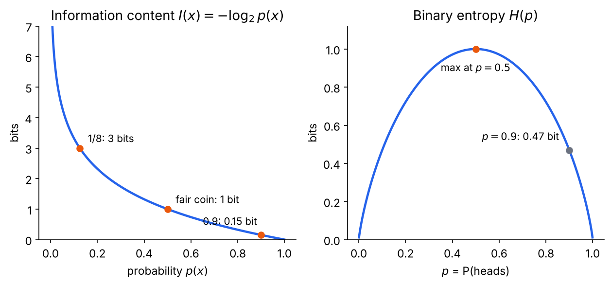
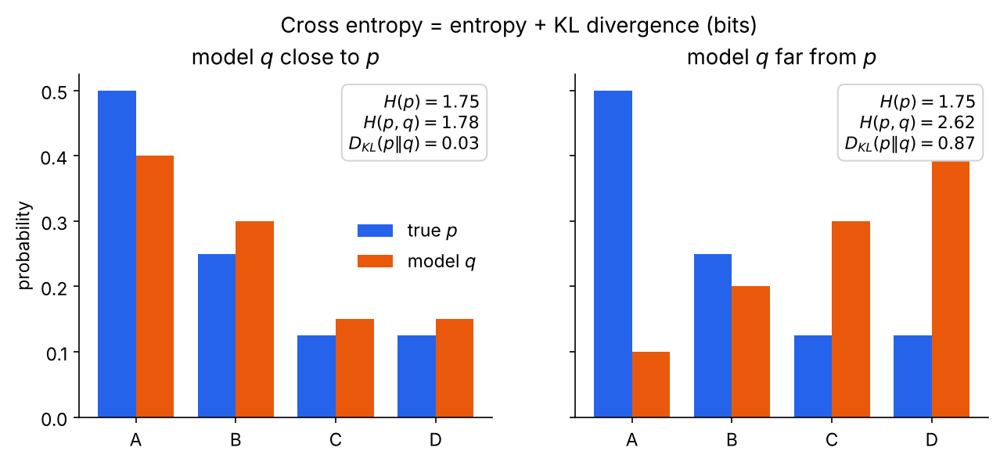
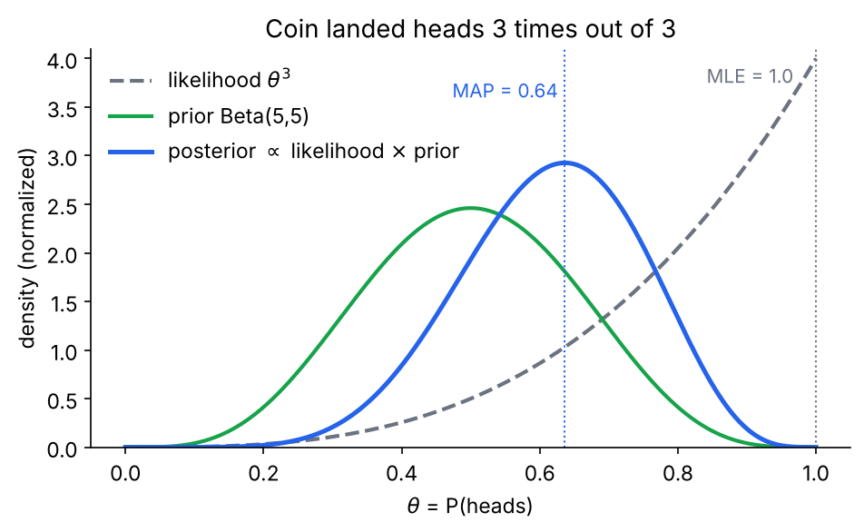
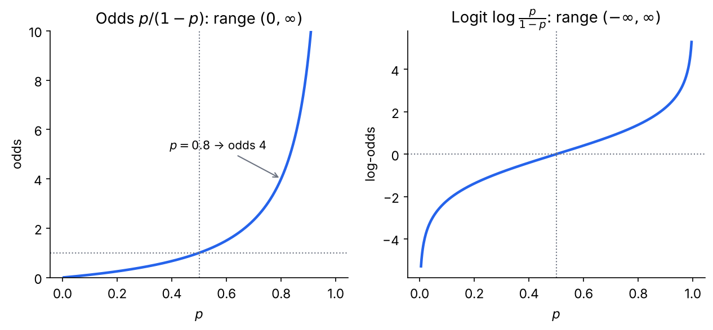
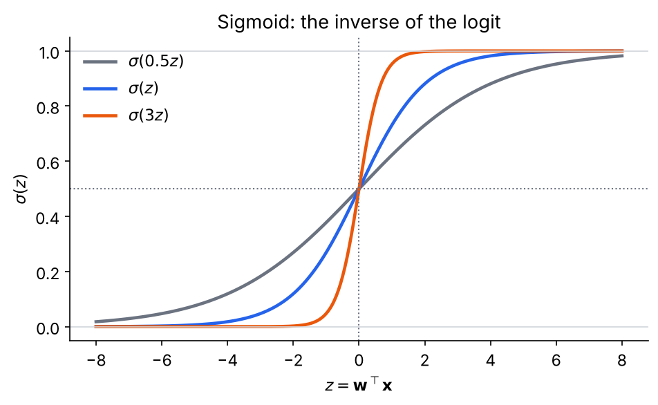
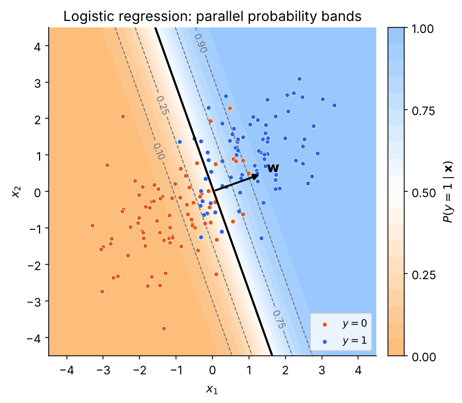
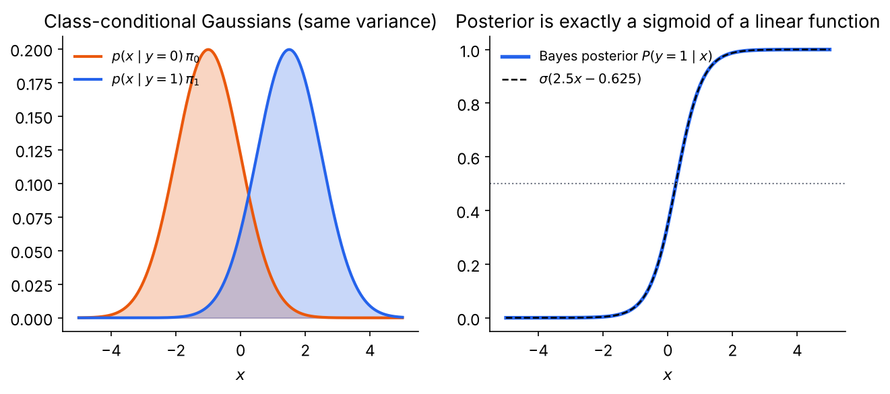
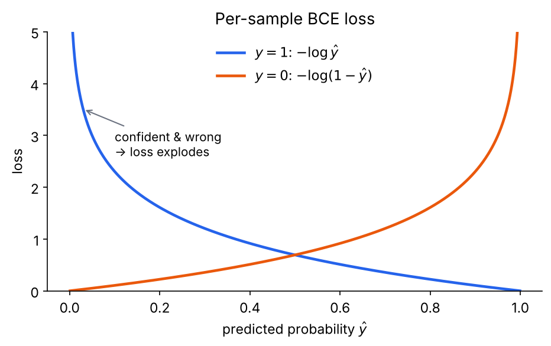
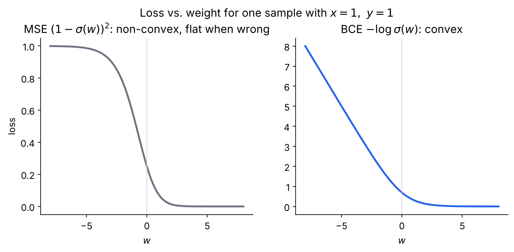
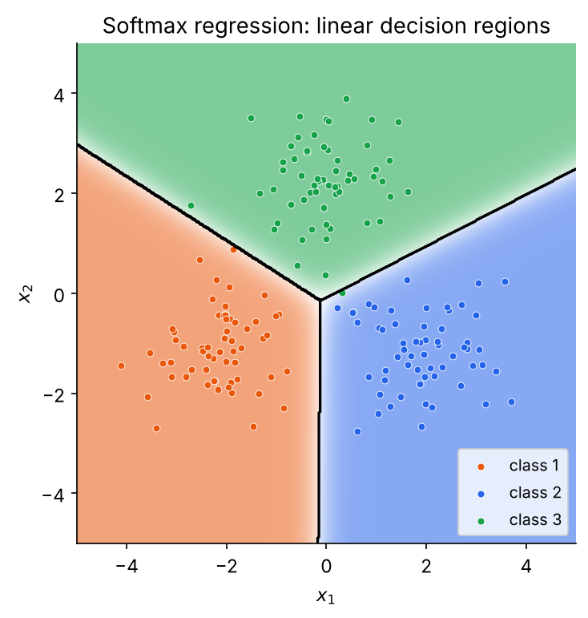

## 들어가며

선형 회귀는 출력이 연속적인 실수일 때 쓰는 모델이었다. 그런데 메일이 스팸인지 아닌지, 종양이 악성인지 양성인지처럼 출력이 0 또는 1인 분류(classification) 문제도 많다. 이때 우리가 진짜 알고 싶은 것은 "1이다/0이다"라는 딱 잘라진 답보다 **"1일 확률이 얼마인가"** 이다. 확률을 알면 0.5를 기준으로 분류할 수도 있고, 암 진단처럼 놓치면 안 되는 문제에서는 기준을 0.2로 낮출 수도 있기 때문이다.

로지스틱 회귀(Logistic Regression)는 바로 이 확률을 출력하는 가장 기본적인 분류 모델이다. 모델 자체는 한 줄이지만, 그 한 줄이 왜 그런 모양인지, 그리고 왜 하필 그런 손실함수로 학습하는지를 제대로 이해하려면 두 가지 도구가 필요하다. 하나는 확률분포 사이의 차이를 재는 **정보 이론**이고, 다른 하나는 데이터로부터 파라미터를 추정하는 **베이즈 관점의 추정 방법**이다. 이 글은 이 두 도구를 먼저 준비한 다음, odds와 logit을 거쳐 로지스틱 회귀 모델을 세우고, 손실함수인 BCE를 유도하고, 마지막으로 클래스가 여러 개인 경우까지 확장한다.

## 정보 이론 (Information Theory)

### 정보량

정보 이론은 "어떤 사건이 일어났다는 사실이 얼마나 많은 정보를 주는가"를 수로 나타내는 것에서 출발한다. 직관적으로 생각해 보면, 매일 뜨는 해가 오늘도 떴다는 소식은 아무런 놀라움을 주지 않는다. 반면 한여름에 눈이 왔다는 소식은 매우 놀랍다. 즉 **드물게 일어나는 사건일수록 더 많은 정보를 담고 있다.**

이 직관을 만족하는 함수를 찾으려면 몇 가지 조건이 필요하다. 확률이 1인 사건의 정보량은 0이어야 하고, 확률이 작을수록 정보량은 커야 한다. 또 서로 독립인 두 사건이 함께 일어났을 때의 정보량은 각각의 정보량의 합이어야 한다. 독립 사건의 확률은 곱해지므로 $p(x, y) = p(x)p(y)$ 인데, 곱을 합으로 바꿔주는 함수는 로그다. 그래서 사건 $x$의 정보량(information content)은 다음과 같이 정의된다.

$$
I(x) = -\log p(x)
$$

로그의 밑을 2로 하면 단위가 비트(bit)가 되고, 자연로그를 쓰면 내트(nat)가 된다. 밑은 상수배 차이일 뿐이라 머신러닝에서는 보통 자연로그를 쓴다. 공정한 동전의 앞면은 $-\log_2 0.5 = 1$ 비트, 확률이 $1/8$ 인 사건은 3비트의 정보를 준다. 아래 왼쪽 그림처럼 확률이 0에 가까워질수록 정보량은 무한히 커진다.



### 엔트로피 (Entropy)

정보량은 사건 하나에 대한 값이다. 이제 확률분포 전체가 평균적으로 얼마나 많은 정보를 주는지, 다시 말해 **결과를 미리 알기가 얼마나 어려운지**를 알고 싶다. 그것은 정보량의 기댓값으로 정의되고, 이를 엔트로피(entropy)라 한다.

$$
H(p) = \mathbb{E}_{x \sim p}\big[-\log p(x)\big] = -\sum_{x} p(x)\log p(x)
$$

엔트로피는 분포의 불확실성을 나타낸다. 결과가 항상 하나로 정해져 있는 분포는 엔트로피가 0이고, 모든 결과가 똑같은 확률로 나오는 균등분포일 때 엔트로피가 가장 크다. 정보 이론의 맥락에서 엔트로피는 "이 분포에서 나오는 결과를 전송하는 데 필요한 평균 비트 수의 하한"이라는 의미도 가진다. 자주 나오는 결과에는 짧은 부호를, 드문 결과에는 긴 부호를 주는 것이 최적이며, 그 평균 길이가 엔트로피다.

### 이진 엔트로피 (Binary Entropy)

결과가 두 가지뿐인 경우, 즉 확률 $p$로 1이 나오고 $1-p$로 0이 나오는 베르누이 분포의 엔트로피를 이진 엔트로피(binary entropy)라 한다. 위의 정의에 결과 두 개를 대입하면 바로 얻어진다.

$$
H(p) = -p\log p - (1-p)\log(1-p)
$$

앞의 오른쪽 그림이 이 함수다. $p = 0.5$ 인 공정한 동전일 때 1비트로 가장 크고, $p$가 0이나 1에 가까워질수록 결과를 거의 확신할 수 있으므로 엔트로피가 0으로 떨어진다. 앞면이 90% 나오는 동전은 약 0.47비트에 불과하다. 이 식의 모양을 기억해 두자. 뒤에서 로지스틱 회귀의 손실함수를 만나면 거의 같은 꼴이 다시 나온다.

### 교차 엔트로피 (Cross Entropy)

머신러닝에서는 분포가 두 개 등장한다. 하나는 데이터가 실제로 따르는 참 분포 $p$이고, 다른 하나는 모델이 예측한 분포 $q$이다. 참 분포를 정확히 모르니 모델 분포 $q$를 기준으로 부호를 설계했다고 해 보자. 그러면 결과 $x$에 $-\log q(x)$ 길이의 부호를 쓰게 되는데, 실제 결과는 $p$에서 나오므로 평균 부호 길이는 다음과 같다. 이것이 교차 엔트로피(cross entropy)다.

$$
H(p, q) = \mathbb{E}_{x \sim p}\big[-\log q(x)\big] = -\sum_{x} p(x)\log q(x)
$$

엔트로피와 비교하면 로그 안의 분포만 $p$에서 $q$로 바뀌었다. $q$가 $p$와 같다면 교차 엔트로피는 엔트로피와 같아지고, $q$가 $p$와 다를수록 잘못된 분포로 부호를 설계한 대가로 평균 길이가 길어진다. 그래서 교차 엔트로피는 **모델 분포가 참 분포를 얼마나 잘 흉내 내는지**를 재는 척도로 쓸 수 있다.

### KL 발산 (KL Divergence)

교차 엔트로피에는 $q$와 상관없이 참 분포 자체의 불확실성인 $H(p)$가 섞여 있다. 순수하게 "잘못된 분포를 쓴 대가"만 보고 싶다면 그 부분을 빼면 된다. 이 차이를 쿨백-라이블러 발산(Kullback-Leibler divergence)이라 한다.

$$
D_{KL}(p \,\|\, q) = H(p, q) - H(p) = \sum_{x} p(x)\log\frac{p(x)}{q(x)}
$$

KL 발산은 항상 0 이상이고, $p = q$ 일 때만 0이 된다(깁스 부등식). 두 분포가 얼마나 다른지를 나타내는 일종의 거리처럼 쓰이지만, $D_{KL}(p\|q) \neq D_{KL}(q\|p)$ 이므로 엄밀한 의미의 거리는 아니다.

아래 그림은 참 분포 $p$ 하나에 대해 서로 다른 두 모델 분포 $q$를 비교한 것이다. 참 분포의 엔트로피는 1.75비트로 고정되어 있고, $q$가 $p$와 비슷한 왼쪽에서는 KL 발산이 0.03비트에 불과하지만, $q$가 엉뚱한 오른쪽에서는 0.87비트로 커지며 교차 엔트로피도 그만큼 커진다.



여기서 머신러닝에 중요한 결론이 나온다. 학습에서 $p$는 데이터가 정해주는 고정된 분포이므로 $H(p)$는 상수다. 따라서

$$
\min_q H(p, q) = \min_q \big[H(p) + D_{KL}(p\|q)\big] \iff \min_q D_{KL}(p\|q)
$$

즉 **교차 엔트로피를 최소화하는 것은 모델 분포를 참 분포에 가깝게 만드는 것과 같다.** 분류 모델의 손실함수로 교차 엔트로피를 쓰는 근거가 바로 이것이다.

## 베이즈 정리 (Bayes' Theorem)

이제 두 번째 도구인 파라미터 추정으로 넘어가자. 데이터 $\mathcal{D}$가 주어졌을 때 모델 파라미터 $\theta$에 대해 무엇을 알 수 있는지를 연결해 주는 것이 베이즈 정리다.

$$
P(\theta \mid \mathcal{D}) = \frac{P(\mathcal{D} \mid \theta)\,P(\theta)}{P(\mathcal{D})}
$$

각 항에는 이름이 있다. $P(\mathcal{D}\mid\theta)$는 파라미터가 $\theta$일 때 지금의 데이터가 관측될 확률로 우도(likelihood)라 한다. $P(\theta)$는 데이터를 보기 전에 파라미터에 대해 가지고 있던 믿음으로 사전확률(prior)이고, $P(\theta\mid\mathcal{D})$는 데이터를 본 뒤 갱신된 믿음으로 사후확률(posterior)이다. 분모 $P(\mathcal{D})$는 $\theta$와 무관한 정규화 상수다. 그래서 흔히 다음과 같이 비례 관계로 쓴다.

$$
\text{posterior} \propto \text{likelihood} \times \text{prior}
$$

이 식에서 무엇을 최대화하느냐에 따라 두 가지 추정 방법이 나온다.

### 최대우도추정 (MLE)

최대우도추정(Maximum Likelihood Estimation, MLE)은 사전확률을 고려하지 않고, **지금 관측된 데이터를 가장 그럴듯하게 만드는 파라미터**를 고른다.

$$
\hat\theta_{\text{MLE}} = \arg\max_\theta P(\mathcal{D}\mid\theta)
$$

데이터 $n$개가 서로 독립이라면 우도는 각 데이터 확률의 곱이 된다. 곱은 다루기 불편하고 수치적으로도 0에 가까워져 위험하므로 로그를 씌운다. 로그는 순증가 함수라서 최댓값의 위치를 바꾸지 않고, 곱을 합으로 바꿔준다.

$$
\hat\theta_{\text{MLE}} = \arg\max_\theta \prod_{i=1}^{n} P(y_i\mid\theta) = \arg\max_\theta \sum_{i=1}^{n}\log P(y_i\mid\theta)
$$

선형 회귀에서 노이즈가 가우시안이라고 가정하고 MLE를 하면 정확히 잔차 제곱합을 최소화하는 문제가 됐던 것을 떠올리자. 손실함수는 하늘에서 떨어진 것이 아니라 **데이터 생성 과정에 대한 가정 + MLE**에서 나온다. 로지스틱 회귀에서도 이 논리를 그대로 따라갈 것이다.

### 최대사후확률추정 (MAP)

MLE는 데이터만 믿는다. 데이터가 충분하면 문제없지만, 데이터가 적으면 극단적인 결론을 내린다. 동전을 세 번 던져 세 번 모두 앞면이 나왔다면, 앞면 확률 $\theta$의 MLE는 $3/3 = 1$, 즉 "이 동전은 절대 뒷면이 나오지 않는다"이다. 상식적으로 받아들이기 어려운 결론이다.

최대사후확률추정(Maximum A Posteriori, MAP)은 사전확률까지 곱해 사후확률을 최대화한다.

$$
\hat\theta_{\text{MAP}} = \arg\max_\theta P(\mathcal{D}\mid\theta)\,P(\theta) = \arg\max_\theta \Big[\log P(\mathcal{D}\mid\theta) + \log P(\theta)\Big]
$$

"동전은 대체로 공정할 것"이라는 믿음을 0.5 근처에 몰린 Beta(5,5) 분포로 표현하고 같은 데이터로 MAP를 구하면 아래 그림처럼 된다. 회색 점선의 우도는 $\theta=1$에서 최대지만, 초록색 사전확률과 곱한 파란 사후확률은 약 0.64에서 최대가 된다. 데이터가 앞면 쪽으로 믿음을 끌어당기되, 사전 믿음이 그것이 극단으로 치닫지 않게 붙잡는 것이다. 데이터가 많아지면 우도 항이 사전확률 항을 압도하므로 MAP는 MLE에 가까워진다.



MAP의 식에서 $\log P(\theta)$ 항은 머신러닝에서 정규화(regularization) 항의 정체이기도 하다. 가중치에 평균 0인 가우시안 사전확률 $P(\mathbf{w}) \propto \exp(-\lambda\|\mathbf{w}\|^2)$ 를 주면 로그를 씌웠을 때 $-\lambda\|\mathbf{w}\|^2$ 가 되므로, MAP는 "손실함수 + L2 정규화"를 최소화하는 것과 같아진다. 라플라스 사전확률을 주면 L1 정규화가 나온다. 앞으로 로지스틱 회귀 손실을 MLE로 유도할 텐데, 여기에 사전확률을 더하면 정규화된 로지스틱 회귀가 된다는 점을 기억해 두자.

## 오즈 (Odds)

준비가 끝났으니 본론으로 들어가자. 목표는 입력 $\mathbf{x}$로 $p = P(y=1\mid\mathbf{x})$ 를 예측하는 모델을 만드는 것이다. 가장 먼저 떠오르는 방법은 선형 회귀를 그대로 쓰는 것이다.

$$
p = \mathbf{w}^\top\mathbf{x}
$$

하지만 이 식은 성립할 수가 없다. 좌변의 확률은 $[0, 1]$ 사이의 값인데, 우변의 선형식은 $\mathbf{x}$에 따라 $(-\infty, \infty)$ 의 어떤 값이든 될 수 있다. 입력이 조금만 커져도 확률이 1.3이나 −0.2가 되어 버린다. 선형식의 장점(단순함, 해석 가능성, 다루기 쉬운 최적화)을 살리고 싶다면, 선형식을 바꾸는 대신 **확률 쪽을 $(-\infty, \infty)$ 범위로 늘려주는 변환**을 찾아야 한다.

그 첫 단계가 오즈(odds)다. 오즈는 어떤 일이 일어날 확률과 일어나지 않을 확률의 비율이다.

$$
\text{odds} = \frac{p}{1-p}
$$

도박이나 스포츠 중계에서 "승산이 4 대 1"이라고 말하는 것이 오즈다. 이길 확률이 0.8이면 질 확률은 0.2이므로 오즈는 4이고, 이길 확률이 0.5면 오즈는 1이다. 확률이 0에서 1로 갈 때 오즈는 0에서 무한대로 간다. 위쪽 범위는 무한대로 열렸지만, 아래쪽은 여전히 0에 막혀 있다. 또 아래 왼쪽 그림처럼 $p=0.5$를 기준으로 비대칭이다. $p$가 0.5보다 작은 쪽은 0과 1 사이에 눌려 있고, 큰 쪽은 1에서 무한대까지 퍼져 있다.



## 로짓 (Logit)

오즈에 로그를 씌우면 두 문제가 한꺼번에 해결된다. $(0, \infty)$ 의 값에 로그를 씌우면 $(-\infty, \infty)$ 가 되고, 로그는 역수를 부호 반전으로 바꿔주므로 $\log\frac{p}{1-p}$ 와 $\log\frac{1-p}{p}$ 는 크기가 같고 부호만 반대다. 즉 $p=0.5$를 중심으로 완벽히 대칭이 된다. 이렇게 확률을 로그 오즈(log-odds)로 바꾸는 함수를 로짓(logit)이라 한다.

$$
\operatorname{logit}(p) = \log\frac{p}{1-p}, \qquad \operatorname{logit}: (0, 1) \to (-\infty, \infty)
$$

앞 그림의 오른쪽이 로짓 함수다. $p=0.5$에서 0이고, 1에 가까워지면 $+\infty$, 0에 가까워지면 $-\infty$ 로 간다. 이제 범위가 선형식과 정확히 맞는다.

## 로지스틱 회귀 (Logistic Regression)

### 모델

범위가 맞았으니 이제 **로그 오즈가 입력의 선형 함수라고 가정**할 수 있다. 이것이 로지스틱 회귀의 핵심 가정이다. 선형 회귀 때처럼 입력 벡터 앞에 1을 붙여 절편을 $\mathbf{w}$에 포함시킨다($\mathbf{x}, \mathbf{w} \in \mathbb{R}^{d+1}$).

$$
\log\frac{p}{1-p} = \mathbf{w}^\top\mathbf{x}
$$

이 식을 $p$에 대해 풀어 보자. 양변에 지수를 취하고 정리하면 된다.

$$
\begin{aligned}
\frac{p}{1-p} &= e^{\mathbf{w}^\top\mathbf{x}} \\
p &= e^{\mathbf{w}^\top\mathbf{x}}(1-p) \\
p\,(1 + e^{\mathbf{w}^\top\mathbf{x}}) &= e^{\mathbf{w}^\top\mathbf{x}} \\
p &= \frac{e^{\mathbf{w}^\top\mathbf{x}}}{1+e^{\mathbf{w}^\top\mathbf{x}}} = \frac{1}{1+e^{-\mathbf{w}^\top\mathbf{x}}}
\end{aligned}
$$

마지막 식의 함수 $\sigma(z) = \frac{1}{1+e^{-z}}$ 를 시그모이드(sigmoid) 또는 로지스틱 함수(logistic function)라 하고, 모델의 이름이 여기서 왔다. 정리하면 로지스틱 회귀 모델은 다음과 같다.

$$
\hat y = P(y=1\mid\mathbf{x}) = \sigma(\mathbf{w}^\top\mathbf{x}) = \frac{1}{1+e^{-\mathbf{w}^\top\mathbf{x}}}
$$

중요한 점은 **시그모이드를 먼저 골라 그 안에 선형식을 넣은 것이 아니라, 로그 오즈를 선형으로 가정했더니 그 역함수로 시그모이드가 나왔다**는 것이다. 시그모이드는 로짓의 역함수다. 아래 그림처럼 시그모이드는 실수 전체를 $(0, 1)$ 로 부드럽게 눌러 주고, $\sigma(0)=0.5$ 이며, 입력에 곱해지는 계수가 클수록 가파르게 변한다.



시그모이드에는 앞으로 계속 쓸 두 가지 성질이 있다. 하나는 대칭성 $1 - \sigma(z) = \sigma(-z)$ 이고, 다른 하나는 미분이 자기 자신으로 표현된다는 것이다.

$$
\sigma'(z) = \frac{e^{-z}}{(1+e^{-z})^2} = \frac{1}{1+e^{-z}}\cdot\frac{e^{-z}}{1+e^{-z}} = \sigma(z)\big(1-\sigma(z)\big)
$$

로그 오즈가 선형이라는 가정은 해석도 깔끔하게 만든다. 다른 특성을 고정하고 $x_j$를 1만큼 늘리면 로그 오즈가 $w_j$만큼 늘어나고, 따라서 오즈는 $e^{w_j}$ 배가 된다. 예를 들어 $w_j = 0.7$ 이면 그 특성이 1 늘 때마다 "1일 승산"이 약 2배가 된다는 뜻이다.

### 결정 경계는 왜 직선인가

로지스틱 회귀는 확률을 출력하지만, 분류를 하려면 기준이 필요하다. 보통 $\hat y \ge 0.5$ 이면 1로 분류한다. 시그모이드는 순증가 함수이고 $\sigma(0) = 0.5$ 이므로 다음이 성립한다.

$$
\sigma(\mathbf{w}^\top\mathbf{x}) \ge 0.5 \iff \mathbf{w}^\top\mathbf{x} \ge 0
$$

로짓 쪽에서 봐도 같은 결론이다. $p \ge 0.5$ 는 오즈 $\ge 1$, 즉 로그 오즈 $\ge 0$ 과 같고, 로그 오즈가 바로 $\mathbf{w}^\top\mathbf{x}$ 이다. 결국 비선형 함수인 시그모이드를 거치지만 실제 분류는 $\mathbf{w}^\top\mathbf{x}$ 의 **부호**만으로 정해지고, 두 클래스를 가르는 결정 경계(decision boundary) $\{\mathbf{x} : \mathbf{w}^\top\mathbf{x} = 0\}$ 은 초평면이다. 그래서 로지스틱 회귀는 선형 분류기(linear classifier)다. 기준을 0.5가 아닌 $t$로 바꿔도 경계는 $\mathbf{w}^\top\mathbf{x} = \operatorname{logit}(t)$ 가 되어 평행이동할 뿐 여전히 초평면이다.

기하학적으로 보면 의미가 더 분명해진다. 절편을 다시 꺼내 $\mathbf{w}^\top\mathbf{x} + b$ 로 쓰면, $\mathbf{w}$는 경계 초평면에 수직인 법선벡터이고, 점 $\mathbf{x}$에서 경계까지의 부호 있는 거리는 $r = \frac{\mathbf{w}^\top\mathbf{x}+b}{\|\mathbf{w}\|}$ 이다. 따라서 모델의 출력은

$$
P(y=1\mid\mathbf{x}) = \sigma\big(\|\mathbf{w}\|\cdot r\big)
$$

로 쓸 수 있다. **확률은 오직 경계로부터의 부호 있는 거리 하나로 결정된다.** 경계 위의 점은 0.5로 가장 애매하고, $\mathbf{w}$가 가리키는 쪽으로 멀어질수록 1에, 반대쪽으로 멀어질수록 0에 가까워진다. 아래 그림은 2차원 데이터에 로지스틱 회귀를 학습한 결과인데, 검은 실선이 결정 경계이고 점선은 확률이 0.1, 0.25, 0.75, 0.9인 등고선이다. 등확률선이 모두 경계와 평행한 직선이라는 것이 선형 분류기의 모습이다. $\|\mathbf{w}\|$는 이 줄무늬의 간격, 즉 경계에서 멀어질 때 확신이 얼마나 빨리 커지는지를 정한다.



### 생성 모델 관점에서 본 시그모이드

로그 오즈를 선형으로 둔 것은 가정이었다. 이 가정이 임의적인 것이 아님을 보여주는 다른 유도가 있다. 이번에는 각 클래스의 데이터가 어떤 분포에서 생성되는지를 먼저 가정하고 베이즈 정리로 사후확률을 계산해 보자. 클래스의 사전확률을 $\pi_k = P(y=k)$ 라 하면

$$
P(y=1\mid\mathbf{x}) = \frac{p(\mathbf{x}\mid 1)\pi_1}{p(\mathbf{x}\mid 1)\pi_1 + p(\mathbf{x}\mid 0)\pi_0} = \frac{1}{1 + \exp(-a)}, \qquad a = \log\frac{p(\mathbf{x}\mid 1)\pi_1}{p(\mathbf{x}\mid 0)\pi_0}
$$

이다. 분자와 분모를 분자로 나누기만 했을 뿐, 분포에 대해서는 아무 가정도 하지 않았다. 그런데도 **클래스가 둘이면 사후확률은 항상 $\sigma(a)$ 꼴**이다. 시그모이드는 이진 분류 사후확률의 원래 모양인 셈이다.

여기에 각 클래스가 공분산이 같은 가우시안 $p(\mathbf{x}\mid k) = \mathcal{N}(\boldsymbol{\mu}_k, \Sigma)$ 를 따른다고 가정하면 $a$를 직접 계산할 수 있다. 로그 밀도의 이차항 $-\frac12\mathbf{x}^\top\Sigma^{-1}\mathbf{x}$ 는 두 클래스에서 똑같으므로 상쇄되고, $\mathbf{x}$에 대해 일차인 항만 남는다.

$$
a = \underbrace{\big(\Sigma^{-1}(\boldsymbol{\mu}_1 - \boldsymbol{\mu}_0)\big)^\top}_{\mathbf{w}^\top}\mathbf{x} + \underbrace{\tfrac12\boldsymbol{\mu}_0^\top\Sigma^{-1}\boldsymbol{\mu}_0 - \tfrac12\boldsymbol{\mu}_1^\top\Sigma^{-1}\boldsymbol{\mu}_1 + \log\frac{\pi_1}{\pi_0}}_{b}
$$

즉 $P(y=1\mid\mathbf{x}) = \sigma(\mathbf{w}^\top\mathbf{x} + b)$ 가 가정이 아닌 **결과**로 나온다. 아래 그림은 1차원에서 평균이 −1과 1.5이고 분산이 1인 두 가우시안으로 이를 확인한 것이다. 베이즈 정리로 계산한 사후확률(파란 실선)이 위 식으로 구한 $\sigma(2.5x - 0.625)$ (검은 점선)와 정확히 겹친다.



이처럼 분포를 가정하고 거기서 분류기를 얻는 방식을 생성 모델(generative model)이라 하고, 이 경우가 선형 판별 분석(LDA)이다. 반면 로지스틱 회귀는 $p(\mathbf{x}\mid y)$를 모델링하지 않고 $\sigma(\mathbf{w}^\top\mathbf{x})$ 라는 형태만 가져와 $\mathbf{w}$를 데이터에서 직접 학습하는 판별 모델(discriminative model)이다. 가우시안 가정이 맞지 않는 데이터에서도 이 형태는 그대로 유효한 경우가 많고(예: 클래스 조건부 분포가 같은 지수족이면 마찬가지로 선형 로그 오즈가 나온다), 그래서 로지스틱 회귀가 더 넓게 쓰인다.

## BCE (Binary Cross Entropy)

### MLE로 유도하기

모델의 모양은 정해졌다. 이제 $\mathbf{w}$를 어떻게 학습할지, 즉 손실함수를 정해야 한다. 선형 회귀에서 그랬듯 데이터가 어떻게 생성되는지 가정하고 MLE를 하면 된다.

로지스틱 회귀는 $\hat y_i = \sigma(\mathbf{w}^\top\mathbf{x}_i)$ 를 "$y_i = 1$일 확률"로 해석한다. 따라서 각 레이블은 베르누이 분포를 따른다고 볼 수 있다: $y_i \sim \text{Bernoulli}(\hat y_i)$. $y_i$가 1일 확률은 $\hat y_i$, 0일 확률은 $1-\hat y_i$ 인데, 이 두 경우를 하나의 식으로 합치면 다음과 같다.

$$
P(y_i\mid\mathbf{x}_i;\mathbf{w}) = \hat y_i^{\,y_i}\,(1-\hat y_i)^{\,1-y_i}
$$

두 확률을 실제로 곱하는 것이 아니라 지수가 스위치 역할을 한다는 점에 주목하자. $y_i = 1$이면 $(1-\hat y_i)^0 = 1$ 이 되어 $\hat y_i$만 남고, $y_i = 0$이면 $\hat y_i^0 = 1$ 이 되어 $1-\hat y_i$만 남는다. if문을 수식으로 쓴 것이다.

데이터가 서로 독립이라고 가정하면 전체 우도는 각 확률의 곱이다.

$$
L(\mathbf{w}) = \prod_{i=1}^{n}\hat y_i^{\,y_i}(1-\hat y_i)^{\,1-y_i}
$$

로그를 씌우면 곱이 합으로, 지수가 계수로 내려온다. 여기에 마이너스를 붙여 최대화 문제를 최소화 문제로 바꾸면 손실함수가 완성된다. 로그는 순증가 함수이고 마이너스는 그래프를 뒤집을 뿐이므로, 최적의 $\mathbf{w}$는 원래 우도를 최대화하는 $\mathbf{w}$와 같다.

$$
J(\mathbf{w}) = -\log L(\mathbf{w}) = -\sum_{i=1}^{n}\Big[\,y_i\log\hat y_i + (1-y_i)\log(1-\hat y_i)\,\Big]
$$

이것이 이진 교차 엔트로피(Binary Cross Entropy, BCE) 손실이다. 실무에서는 데이터 수 $n$으로 나눈 평균을 쓰는 경우가 많은데, 상수배는 최솟값의 위치를 바꾸지 않는다. 여기서 합 기호 $\Sigma$ 안의 각 항

$$
\ell_i = -\Big[\,y_i\log\hat y_i + (1-y_i)\log(1-\hat y_i)\,\Big]
$$

은 $i$번째 데이터 하나에 대한 손실이다. 전체 손실은 데이터별 손실의 합이며, 이것은 데이터가 독립이라는 가정 덕분에 우도가 곱으로 쪼개졌기 때문이다. 선형 회귀의 잔차 제곱합에서 각 항이 데이터별 제곱오차였던 것과 같은 구조다. (합 기호 $\Sigma$와 시그모이드 $\sigma$는 전혀 다른 기호라는 점도 혼동하지 말자.)

### 교차 엔트로피와의 관계

이 손실에 교차 엔트로피라는 이름이 붙은 이유는 정보 이론 부분을 떠올리면 바로 보인다. $i$번째 데이터의 정답을 분포 $p_i = (y_i,\ 1-y_i)$ 로, 모델 예측을 분포 $q_i = (\hat y_i,\ 1-\hat y_i)$ 로 보면

$$
H(p_i, q_i) = -\sum_{k\in\{1,0\}}p_i(k)\log q_i(k) = -\big[y_i\log\hat y_i + (1-y_i)\log(1-\hat y_i)\big] = \ell_i
$$

로 정확히 같다. 이진 엔트로피 식에서 로그 안의 $p$만 모델 예측 $\hat y$로 바뀐 모양이다. 앞에서 교차 엔트로피 최소화가 KL 발산 최소화와 같다는 것을 보였으므로, **BCE를 최소화하는 것은 베르누이 우도를 최대화하는 것이자, 모델의 예측 분포를 정답 분포에 가깝게 만드는 것**이다. 정보 이론과 MLE라는 두 길이 같은 손실함수에서 만난다.

### 손실의 모양

$y_i$는 0 아니면 1이므로 각 데이터의 손실은 두 항 중 하나만 살아남는다. 정답이 1이면 $-\log\hat y_i$, 정답이 0이면 $-\log(1-\hat y_i)$ 이다. 아래 그림을 보면 정답 쪽으로 높은 확률을 예측할수록 손실은 0에 가까워지고, 반대로 **틀린 답을 강하게 확신할수록 손실이 무한대로 치솟는다.** 정답이 1인데 0.01을 예측하면 손실이 약 4.6이나 된다. BCE는 자신 있게 틀리는 것을 아주 엄하게 벌한다.



$y_i = 1$인데 뒤쪽 항에서 $\log 0$ 이 나오지 않을까 걱정할 수 있다. 수학적으로는 $\hat y_i = \sigma(\cdot)$ 가 열린 구간 $(0,1)$ 에 있으므로 $\log(1-\hat y_i)$ 는 항상 유한하고, 0이 곱해져 사라진다. 하지만 컴퓨터에서는 $\mathbf{w}^\top\mathbf{x}$ 가 40 정도만 돼도 부동소수점에서 $\sigma$가 1.0으로 반올림되어 $0\times(-\infty)$ = NaN이 나올 수 있다. 그래서 구현에서는 $\hat y$를 $[\epsilon, 1-\epsilon]$ 로 잘라 쓰거나, $z = \mathbf{w}^\top\mathbf{x}$ 에서 바로 $\log\sigma(z) = -\log(1+e^{-z})$, $\log(1-\sigma(z)) = -\log(1+e^{z})$ 를 계산한다. PyTorch의 `BCEWithLogitsLoss`가 후자의 방식이다.

### 왜 MSE가 아닌가

선형 회귀처럼 $(y_i - \hat y_i)^2$ 을 손실로 쓰면 안 될까? 쓸 수는 있지만 좋지 않다. 데이터가 하나($x=1$, $y=1$)인 가장 단순한 경우로 손실을 가중치 $w$의 함수로 그려 보면 차이가 분명하다.



MSE를 시그모이드와 합성하면 왼쪽처럼 볼록하지 않은 함수가 된다. 특히 $w$가 크게 음수인 영역, 즉 모델이 완전히 틀린 영역에서 손실이 평평해져 gradient가 거의 0이 된다. 가장 많이 고쳐야 할 때 학습이 멈추는 것이다. 반면 BCE는 오른쪽처럼 볼록하고, 틀린 영역에서는 거의 직선으로 일정한 기울기를 유지한다. 이는 $-\log$가 시그모이드의 지수 함수를 정확히 상쇄하기 때문이다. 일반적으로 BCE는 $\mathbf{w}$에 대해 볼록함수이므로(Hessian $X^\top S X$, $S = \operatorname{diag}(\hat y_i(1-\hat y_i))$ 가 양의 준정부호) 지역 최솟값에 갇힐 걱정이 없다.

### Gradient와 학습

BCE를 최소화하는 $\mathbf{w}$는 선형 회귀의 정규방정식처럼 닫힌 형태로 구할 수 없다. 대신 gradient를 구해 경사하강법을 쓴다. 데이터 하나의 손실 $\ell_i$를 연쇄법칙으로 미분하면, $z_i = \mathbf{w}^\top\mathbf{x}_i$ 라 할 때

$$
\frac{\partial\ell_i}{\partial z_i} = -\frac{y_i}{\hat y_i}\,\hat y_i(1-\hat y_i) + \frac{1-y_i}{1-\hat y_i}\,\hat y_i(1-\hat y_i) = -y_i(1-\hat y_i) + (1-y_i)\hat y_i = \hat y_i - y_i
$$

이다. 시그모이드의 미분 $\hat y(1-\hat y)$ 가 로그의 미분 분모와 깔끔하게 약분된 결과다. $\frac{\partial z_i}{\partial\mathbf{w}} = \mathbf{x}_i$ 이므로 전체 gradient는

$$
\nabla_{\mathbf{w}}J = \sum_{i=1}^{n}(\hat y_i - y_i)\,\mathbf{x}_i = X^\top(\hat{\mathbf{y}} - \mathbf{y})
$$

가 된다. 놀랍게도 선형 회귀의 MSE gradient $X^\top(X\mathbf{w} - \mathbf{y})$ 와 모양이 똑같다. 다른 점은 예측값이 $X\mathbf{w}$ 대신 $\sigma(X\mathbf{w})$ 라는 것뿐이다. 각 데이터의 "예측 오차 $\hat y_i - y_i$"만큼 그 입력 방향으로 가중치를 고치는 직관적인 규칙이다. 경사하강법의 업데이트는 다음과 같다.

$$
\mathbf{w}^{(t+1)} = \mathbf{w}^{(t)} - \eta\,X^\top\big(\sigma(X\mathbf{w}^{(t)}) - \mathbf{y}\big)
$$

NumPy로 쓰면 몇 줄이면 된다. 손실은 수치적으로 안정한 형태로 계산했다.

```python
import numpy as np

rng = np.random.default_rng(0)
n = 200
X0 = rng.normal([-1.0, -0.5], 1.0, size=(n // 2, 2))
X1 = rng.normal([1.0, 1.0], 1.0, size=(n // 2, 2))
X = np.c_[np.ones(n), np.r_[X0, X1]]           # 설계행렬: bias 열 + 특성
y = np.r_[np.zeros(n // 2), np.ones(n // 2)]

sigmoid = lambda z: 1 / (1 + np.exp(-z))

def bce(w):
    z = X @ w
    # log(1+e^z) - y z  ==  -[y log s + (1-y) log(1-s)]
    return np.mean(np.logaddexp(0, z) - y * z)

w = np.zeros(3)
eta = 0.1
for _ in range(3000):
    grad = X.T @ (sigmoid(X @ w) - y) / n
    w -= eta * grad

acc = np.mean((X @ w >= 0) == y)               # 분류는 w^T x 의 부호로
print(w, bce(w), acc)
```

한 가지 주의할 점이 있다. 데이터가 직선으로 완벽히 분리되면, 모든 데이터를 더 확신 있게 맞히기 위해 $\|\mathbf{w}\|$ 를 키우는 것이 항상 손실을 줄인다. 그래서 $\mathbf{w}$가 무한히 커지며 수렴하지 않는다. 이때 MAP 부분에서 본 L2 정규화 $\lambda\|\mathbf{w}\|^2$ 를 더하면 해가 유한한 곳에서 정해진다.

## 다중 클래스 분류 (Multiclass Classification)

지금까지는 클래스가 두 개였다. 손글씨 숫자처럼 클래스가 $K$개라면 어떻게 할까?

### One-vs-Rest

가장 간단한 방법은 이진 분류기를 여러 개 쓰는 것이다. 클래스마다 "이 클래스인가, 아닌가"를 판별하는 로지스틱 회귀를 하나씩, 총 $K$개 학습하고, 예측할 때는 가장 높은 확률을 낸 클래스를 고른다. 이를 One-vs-Rest(OvR)라 한다. 구현은 쉽지만 각 분류기가 따로 학습되므로 $K$개의 출력을 더해도 1이 되지 않아 확률로 해석하기 어렵고, 한 클래스 대 나머지 전체라는 불균형한 문제를 풀게 된다.

### Softmax 회귀

더 자연스러운 방법은 로지스틱 회귀 자체를 $K$개 클래스로 일반화하는 것이다. 이진의 경우 로그 오즈가 선형이라고 가정했으니, 다중 클래스에서는 기준 클래스 $K$에 대한 각 클래스의 로그 오즈가 선형이라고 가정한다.

$$
\log\frac{P(y=k\mid\mathbf{x})}{P(y=K\mid\mathbf{x})} = \mathbf{w}_k^\top\mathbf{x}, \qquad k = 1, \dots, K-1
$$

이 식들과 확률의 합이 1이라는 조건을 함께 풀면, 기준 클래스의 가중치를 $\mathbf{w}_K = \mathbf{0}$ 으로 두었을 때 다음과 같은 모양이 나온다.

$$
P(y=k\mid\mathbf{x}) = \frac{\exp(\mathbf{w}_k^\top\mathbf{x})}{\sum_{j=1}^{K}\exp(\mathbf{w}_j^\top\mathbf{x})}
$$

이 함수를 소프트맥스(softmax)라 한다. 각 클래스에 선형 점수 $z_k = \mathbf{w}_k^\top\mathbf{x}$ (logit)를 매기고, 지수를 취해 양수로 만든 뒤 전체 합으로 나눠 확률로 정규화하는 것이다. 지수 함수 때문에 점수가 가장 큰 클래스가 확률을 크게 가져가므로 "부드러운 최댓값"이라는 이름이 붙었다. 실제 구현에서는 대칭성을 위해 $K$개의 가중치를 모두 학습하는 경우가 많은데, 모든 $\mathbf{w}_k$에 같은 벡터를 더해도 확률이 변하지 않으므로 결과는 같다.

$K=2$일 때 소프트맥스는 정확히 시그모이드가 된다. 분자와 분모를 $\exp(z_1)$로 나누면

$$
P(y=1\mid\mathbf{x}) = \frac{e^{z_1}}{e^{z_1} + e^{z_2}} = \frac{1}{1 + e^{-(z_1 - z_2)}} = \sigma\big((\mathbf{w}_1 - \mathbf{w}_2)^\top\mathbf{x}\big)
$$

이므로, 로지스틱 회귀는 소프트맥스 회귀의 특수한 경우다.

### Categorical Cross Entropy

손실함수도 같은 방식으로 일반화된다. 이번에는 레이블이 베르누이가 아니라 범주형(categorical) 분포를 따른다고 보고 MLE를 한다. 정답을 원-핫 벡터 $\mathbf{y}_i$ (정답 클래스만 1)로 쓰고 모델 예측을 $\hat{\mathbf{y}}_i$ 라 하면, 한 데이터의 확률은 $\prod_k \hat y_{ik}^{\,y_{ik}}$ 이고 음의 로그 우도는

$$
J = -\sum_{i=1}^{n}\sum_{k=1}^{K} y_{ik}\log\hat y_{ik}
$$

이다. 이것이 범주형 교차 엔트로피(categorical cross entropy)이며, 정답 분포와 예측 분포 사이의 교차 엔트로피라는 점도 이진의 경우와 같다. 원-핫이므로 실제로는 데이터마다 정답 클래스 $c_i$에 대한 $-\log\hat y_{i c_i}$ 항 하나만 남는다. $K=2$를 대입하면 BCE가 된다.

gradient도 이진의 경우와 똑같이 깔끔하다. 소프트맥스와 교차 엔트로피를 함께 미분하면 logit에 대한 gradient가 $\hat{\mathbf{y}}_i - \mathbf{y}_i$ 가 되어,

$$
\nabla_{\mathbf{w}_k}J = \sum_{i=1}^{n}(\hat y_{ik} - y_{ik})\,\mathbf{x}_i
$$

를 얻는다. "예측 확률 − 정답"을 입력 방향으로 되돌린다는 같은 원리다.

### 결정 경계

소프트맥스 회귀는 확률이 가장 큰 클래스, 즉 점수 $\mathbf{w}_k^\top\mathbf{x}$ 가 가장 큰 클래스로 분류한다. 두 클래스 $k, j$의 경계는 두 점수가 같아지는 곳 $(\mathbf{w}_k - \mathbf{w}_j)^\top\mathbf{x} = 0$ 이므로 역시 초평면이다. 그래서 아래 그림처럼 입력 공간이 직선 경계들로 나뉜 볼록한 영역들로 쪼개진다. 색이 진할수록 그 클래스의 확률이 높고, 경계 근처에서는 흐려진다. 다중 클래스로 확장해도 로지스틱 회귀는 여전히 선형 분류기다.



## 마무리

로지스틱 회귀는 "확률은 선형식으로 바로 모델링할 수 없으니, 확률을 로짓으로 늘려 선형식과 범위를 맞춘다"는 아이디어에서 출발한다. 로그 오즈가 선형이라는 가정을 확률에 대해 풀면 시그모이드가 나오고, 그 결정 경계는 $\mathbf{w}^\top\mathbf{x} = 0$ 이라는 초평면이다. 이 형태는 같은 공분산의 가우시안 클래스를 가정한 베이즈 사후확률과도 정확히 일치한다.

학습에 쓰는 BCE는 레이블이 베르누이 분포를 따른다는 가정 아래의 음의 로그 우도이고, 동시에 정답 분포와 예측 분포 사이의 교차 엔트로피다. 교차 엔트로피 최소화는 KL 발산 최소화와 같으므로, 결국 BCE를 줄이는 것은 모델의 예측 분포를 데이터의 분포에 맞추는 일이다. BCE는 볼록하고 gradient가 $X^\top(\hat{\mathbf{y}} - \mathbf{y})$ 라는 단순한 형태라서 경사하강법으로 안정적으로 학습되며, 여기에 사전확률을 더한 MAP가 정규화된 로지스틱 회귀다. 클래스가 여러 개면 시그모이드는 소프트맥스로, BCE는 범주형 교차 엔트로피로 자연스럽게 일반화되고, 이 "선형 점수 + 소프트맥스 + 교차 엔트로피" 조합은 신경망 분류기의 마지막 층에서 그대로 다시 만나게 된다.
