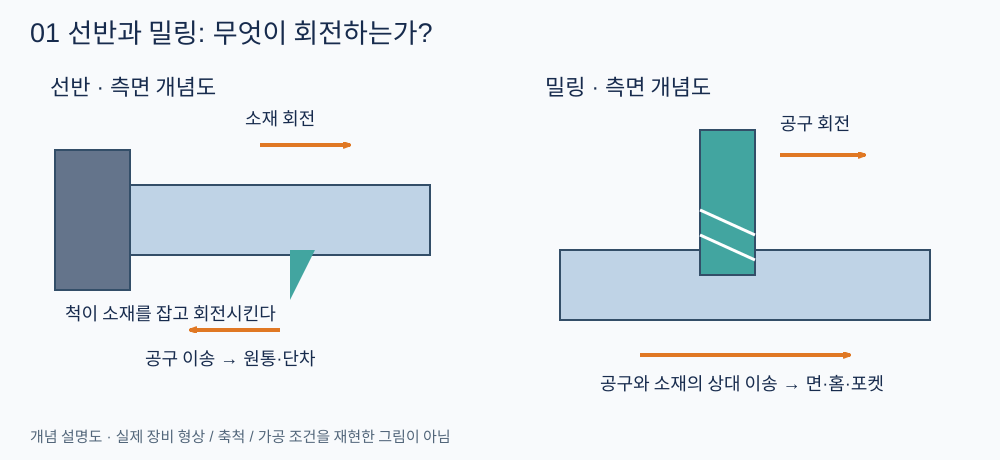
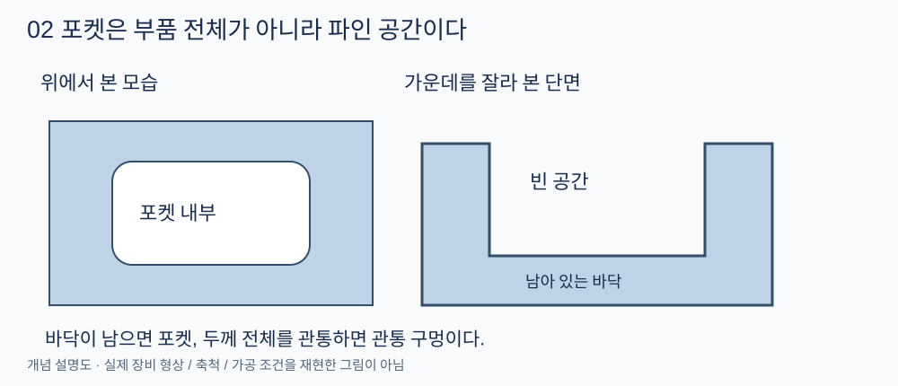
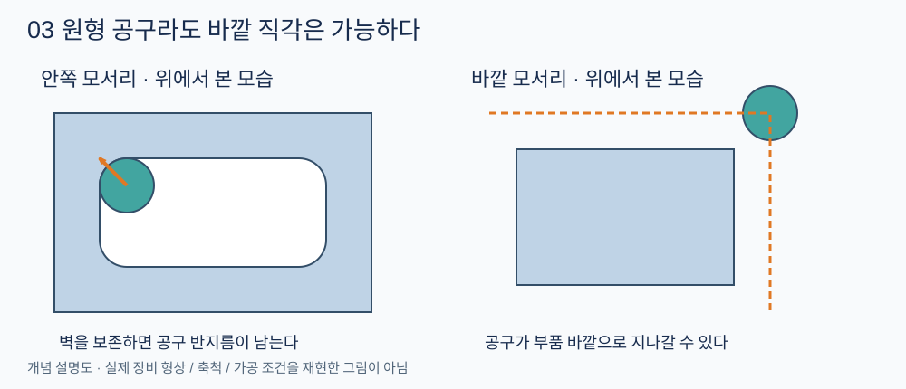
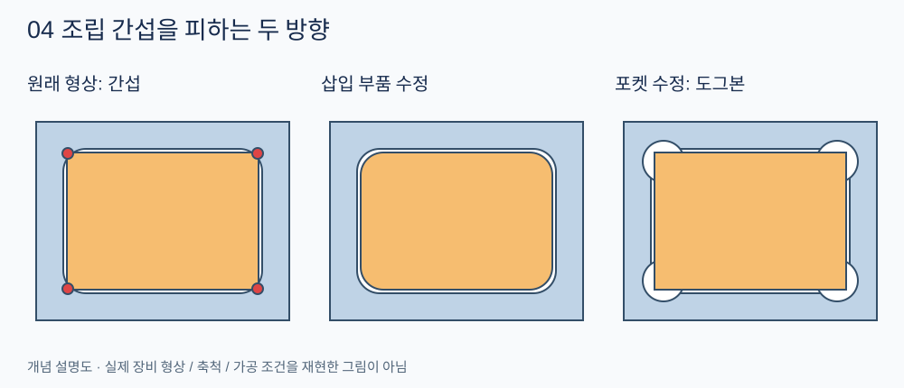
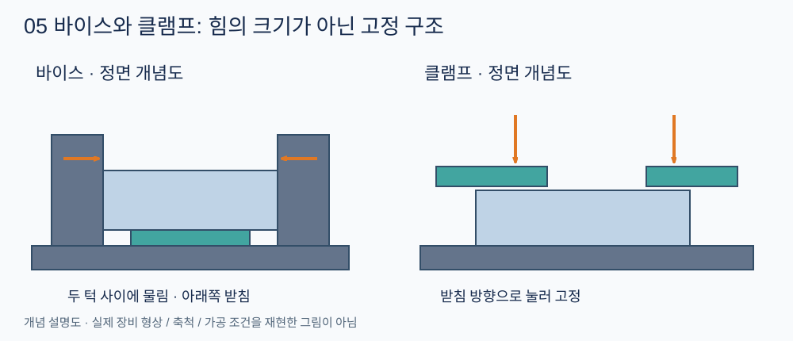
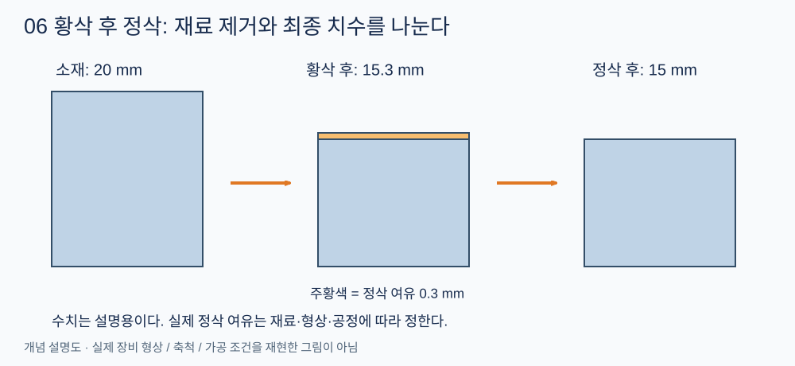
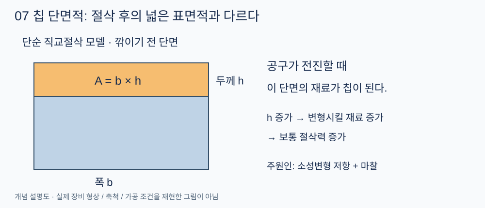
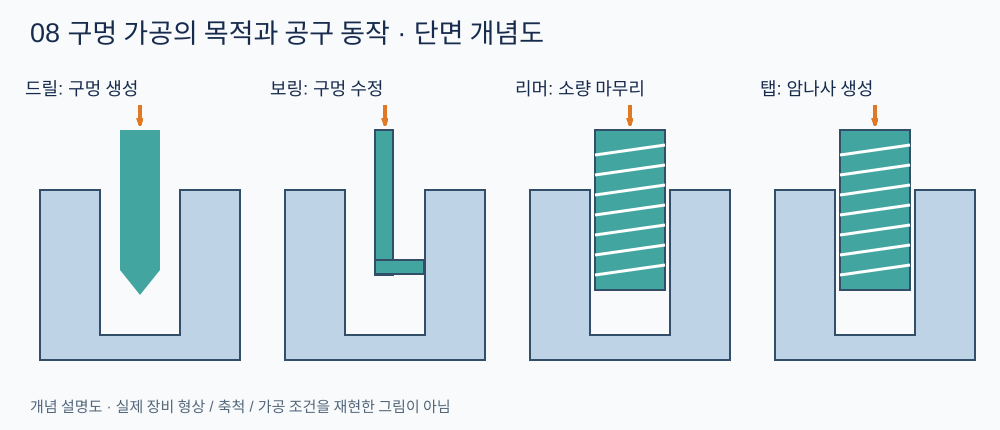

## 절삭가공은 무엇을 하는가

절삭가공(Machining)은 공구로 소재의 일부를 제거해 원하는 형상과 치수를 만드는 방법이다. 제거되어 나온 조각을 **칩(Chip)**, 가공 대상인 재료나 부품을 **공작물(Workpiece)**이라고 한다. 제작법은 절삭뿐 아니라 주조, 성형, 접합, 적층제조 등을 포함하는 더 넓은 개념이다.

도면을 실제 부품으로 구현하려면 공법 이름만 아는 것으로는 부족하다. **공구가 어느 방향으로 접근하는지, 재료를 어떻게 고정하는지, 가공 후 조립이 가능한지**를 함께 판단해야 한다. 이번 글은 이 판단에 필요한 절삭가공의 첫 번째 개관이다.

> 이 글의 그림은 이해를 위해 직접 작성한 개념 설명도이다. 실제 장비의 구조·축척·절삭 조건을 그대로 재현하지 않는다. 그림에서 파란색은 소재, 초록색은 공구 또는 고정 장치, 주황색은 움직임이나 제거 대상 등을 나타낸다. 각 그림의 설명을 함께 읽는다.

## 선반과 밀링: 회전하는 대상의 차이

### 선반은 소재를 회전시킨다

선삭(Turning)에서는 보통 척(Chuck)이 소재를 잡고 회전시키고, 절삭공구가 이동하며 소재를 깎는다. 이를 수행하는 공작기계가 선반(Lathe)이다. 원통의 바깥지름을 줄이거나, 구간별로 지름이 다른 단차축을 만드는 데 적합하다.

모터축을 예로 들면 소재를 고정하고, 회전축을 기준으로 바깥면을 깎고, 필요한 구간에 단차와 홈을 만든다. 아래 설명도에서는 소재의 회전과 공구의 길이 방향 이송을 구분해 본다.

### 밀링은 공구를 회전시킨다

밀링(Milling)은 여러 절삭날이 있는 공구를 회전시키면서 소재와 공구를 상대 이동시켜 깎는 가공이다. 장비 구조에 따라 테이블, 공구 또는 양쪽이 움직인다. 평면, 홈, 포켓, 브래킷의 외형 등 다양한 형상을 만들 수 있다.

| 구분 | 선반 | 밀링 |
|---|---|---|
| 기본 회전 운동 | 공작물 회전 | 공구 회전 |
| 대표 형상 | 원통, 단차, 원뿔, 나사 | 평면, 홈, 포켓, 복잡한 외형 |
| 부품 예 | 축, 핀, 부시 | 하우징, 브래킷, 플레이트 |

하나의 부품에 여러 공법을 사용할 수 있다. 예를 들어 축의 원통과 단차는 선삭하고, 축 옆면의 키홈은 밀링으로 가공할 수 있다. 위 비교는 기본적인 가공 방식의 구분이며, 복합가공기는 한 장비에서 여러 작업을 수행하기도 한다.

### CNC는 별도의 가공법인가

**CNC(Computer Numerical Control)는 기계의 움직임 등을 컴퓨터로 수치 제어하는 방식**이다. 선반·밀링과 나란히 놓이는 별도의 제거 원리가 아니다. 수동으로 조작하는 범용 선반과 CNC 선반이 있고, 밀링 역시 수동 또는 CNC 방식으로 제어할 수 있다.

따라서 현장에서 “CNC가 있다”는 말만으로 가공 가능한 소재와 형상을 판단할 수 없다. CNC 선반인지, 밀링인지, 라우터인지와 함께 장비 사양을 확인해야 한다. 밀링 머시닝센터는 일반적으로 자동 공구 교환 기능 등을 갖추어 여러 가공을 연속 수행하는 장비이다.

## 포켓과 안쪽 모서리의 가공 제약

### 포켓은 판 자체가 아니다

포켓(Pocket)은 부품에 오목하게 파인 공간이다. 바닥이 남아 있으며, 소재 두께 전체를 통과하는 관통 구멍과 구분한다. 포켓에 별도의 사각형 부품을 끼워 넣는 상황을 생각해 보자.

### 원형 공구로 바깥 직각은 되지만 안쪽 직각은 어려운 이유

일반적인 원통형 엔드밀(End mill)로 사각 포켓의 수직 벽을 가공하면, 위에서 보았을 때 안쪽 모서리에 반지름이 남는다. 공구가 직각 꼭짓점까지 더 들어가면 남겨야 하는 옆 벽도 깎아버리기 때문이다. 작은 공구를 사용하면 반지름을 줄일 수 있지만, 유한한 반지름을 가진 공구로 완전한 안쪽 직각을 만들 수는 없다.

반면 사각형 부품의 **바깥쪽 윤곽**은 직각으로 만들 수 있다. 공구가 부품 밖으로 지나갈 수 있기 때문이다. 원형 공구라는 사실만으로 모든 모서리가 둥글어지는 것은 아니다.

이 구분은 일반적인 엔드밀로 수직 벽을 가공하는 상황에 대한 설명이다. 안쪽 직각이 반드시 필요하다면 방전가공 등 다른 공법의 검토가 필요하며, 해당 공법은 이후에 다룬다.

### 조립 간섭을 해결하는 두 방향

포켓에 직각 꼭짓점을 가진 판을 끼우면, 안쪽 모서리에 남은 재료와 판의 꼭짓점이 간섭할 수 있다. 해결 방향은 크게 두 가지다.

1. **삽입 부품 수정:** 바깥 꼭짓점을 라운드(Round) 또는 모따기(Chamfer)로 제거한다.
2. **포켓 수정:** 꼭짓점 주변을 추가 가공해 공구가 빠져나갈 공간을 만든다. 도그본(Dog-bone) 릴리프가 한 예다.

그림의 빨간 점은 간섭 위치를 강조한 표시다. 도그본의 위치·크기는 실제 삽입 부품의 꼭짓점이 닿지 않도록 정해야 한다. 라운드 역시 원형 엔드밀을 쓴다고 자동으로 생기는 것이 아니라, 바깥 윤곽을 따라 공구 경로를 만들어 가공한다. 실제 조립에서는 형상뿐 아니라 치수공차와 조립 여유도 함께 검토한다.

## 공작물 고정: 바이스와 클램프

공구가 소재를 깎으면 공작물에도 힘이 작용한다. 공작물이 움직이면 치수 오차가 발생하고, 고정이 풀리면 위험하다. 가공 전에는 소재의 위치를 정하고, 받치고, 절삭력을 견디도록 고정해야 한다.

| 장치 | 고정 구조 | 대표 사용 |
|---|---|---|
| 바이스(Vise) | 고정 턱과 이동 턱 사이에 공작물을 물린다 | 평행한 면이 있는 블록 |
| 클램프(Clamp) | 공작물을 테이블·받침·고정구 쪽으로 누른다 | 넓은 판, 크거나 불규칙한 부품 |

바이스도 보통 공작기계 테이블에 고정한다. “테이블 위에서는 클램프, 공중에서는 바이스”로 구분하지 않는다. 바이스 역시 넓은 의미에서는 클램핑 장치이며, 고정력의 크기는 각 장치의 구조와 크기에 따라 달라진다.

### 세게 고정할수록 좋은가

고정력은 충분해야 하지만, 고정하는 힘 때문에 부품이 변형되어서는 안 된다. 얇은 판을 길이 방향으로 압축하면 가운데가 휘는 좌굴이 발생할 수 있고, 받침이 없는 곳을 클램프로 누르면 판이 휠 수 있다. 접촉 부위만 눌리는 국부적인 변형과는 구분해야 한다.

탄성적으로 휜 상태에서 윗면을 평평하게 가공해도, 고정을 풀면 복원되면서 윗면이 더 이상 평평하지 않을 수 있다. 모든 판이 바이스에 물리면 휘는 것은 아니다. 형상, 고정 방향, 고정력, 받침 위치를 함께 본다.

## 황삭과 정삭을 나누는 이유

황삭(Roughing)은 불필요한 재료를 효율적으로 제거하는 단계이고, 정삭(Finishing)은 최종 치수·형상·표면 상태를 맞추는 단계이다. 황삭 후에는 정삭에서 제거할 소량의 재료, 즉 정삭 여유를 남긴다.

예를 들어 두께 20 mm인 소재의 한쪽 면을 깎아 15 mm로 만든다면, 황삭으로 15.3 mm까지 가공한 후 남은 0.3 mm를 정삭할 수 있다. 이는 개념 설명용 수치이며 실제 여유는 재료·형상·공정에 따라 정한다. 황삭과 정삭은 여러 번의 공구 통과로 이루어질 수 있다.

처음부터 조금씩만 깎으면 가공 시간이 길어져 생산성이 떨어진다. 반대로 많은 양을 제거하는 조건으로 최종 치수까지 가공하면 절삭력·변형·진동의 영향을 관리하기 어려울 수 있다. 정삭에서는 보통 제거량을 줄여 최종 치수를 맞춘다. 다만 황삭만으로 요구 공차를 만족할 수 있는 경우도 있으므로 정삭이 모든 부품에 필수인 것은 아니다.

“정삭하듯 가공하면 전력을 반드시 더 쓴다”는 단정도 피한다. 총에너지는 순간 소비전력과 전체 가공 시간을 함께 고려해야 한다.

## 절삭력: 칩의 질량보다 재료의 변형 저항

### 항복했다고 곧바로 떨어지는 것은 아니다

절삭력(Cutting force)은 가공 중 공구와 공작물 사이에 작용하는 힘이다. 연성 금속의 절삭에서는 공구 앞쪽 재료가 크게 소성변형되며, 주로 전단변형을 통해 칩이 형성된다. 칩은 공구의 경사면(Rake face)을 따라 흘러나간다. 항복은 영구 변형의 시작을 뜻하며, 즉시 재료가 분리된다는 뜻은 아니다.

공구와 소재가 서로 반대 방향의 힘을 받는 것은 작용·반작용의 관계다. 이것만으로 칩의 형성 원리가 설명되지는 않는다. 일반적인 금속 절삭에서 큰 힘이 필요한 주된 이유는 칩의 질량을 가속하는 관성보다 **재료를 소성변형시키는 저항과 공구 접촉면의 마찰**이다.

### 어떤 단면적이 중요한가

단순 직교절삭 모델에서 깎이기 전 칩의 폭을 $b$, 두께를 $h$라 하면, 미변형 칩 단면적은 다음과 같다.

$$
A_c=bh, \qquad F_c\approx k_c A_c
$$

$F_c$는 주절삭력, $k_c$는 비절삭저항이다. $k_c$는 재료뿐 아니라 칩 두께, 공구 형상과 가공 조건 등에도 영향을 받으므로 고정된 재료 상수로 취급하지 않는다. 위 식은 전체 경향을 이해하기 위한 근사식이다.

여기서 면적은 **절삭 후 드러난 넓은 표면적이 아니라, 공구 진행 방향에 대해 제거되는 재료의 단면적**이다. 다른 조건이 유사할 때 이 단면적이 커지면 변형시킬 재료가 많아져 절삭력이 커지는 경향이 있다. 밀링에서는 날의 위치에 따라 칩 두께와 힘이 계속 달라지므로 이 단순 모델을 그대로 장비 설정값으로 사용하지 않는다.

### 마찰을 이기는 것과 빠르게 깎는 것은 다르다

칩이 공구 경사면을 누르면서 미끄러지므로 마찰이 그 상대 운동을 방해한다. 절삭을 계속하려면 이 저항에도 에너지를 공급해야 한다. 천천히 깎아도 마찰은 존재한다.

같은 마찰력이라면 마찰에 소비되는 동력은 상대 속도에 비례한다.

$$
P_{\mathrm{friction}}=F_{\mathrm{friction}}v_{\mathrm{relative}}
$$

실제 절삭에서는 속도에 따라 온도와 접촉 상태가 달라지므로, 빠르게 깎을수록 마찰력 자체가 반드시 커지는 것은 아니다.

절삭력이 커지면 공구나 공작물이 휘고 진동이 발생할 수 있다. 그 결과 명령한 공구 위치와 실제 날끝 위치가 달라져 치수 오차와 표면 품질 저하로 이어질 수 있다. 부품이 도면과 다르게 나왔다면 곧바로 설계 치수를 바꾸기보다 측정, 공구, 고정, 가공 조건과 보정 상태부터 확인해야 한다.

## 구멍을 만드는 가공과 마무리 가공

| 공법 | 하는 일 | 대표 목적 |
|---|---|---|
| 드릴링(Drilling) | 재료에 구멍을 만든다 | 볼트 통과 구멍, 후속 가공용 기초 구멍 |
| 보링(Boring) | 기존 구멍의 안쪽을 절삭한다 | 지름·형상·축 위치의 수정 및 정밀 가공 |
| 리밍(Reaming) | 기존 구멍에서 소량을 제거한다 | 구멍 지름과 표면의 정밀 마무리 |
| 탭 가공(Tapping) | 구멍 안쪽에 나사산을 만든다 | 볼트를 직접 체결하는 암나사 |
| 연삭(Grinding) | 숫돌의 미세한 입자로 깎는다 | 축·평면 등의 정밀 마무리 |

위 그림은 각 공구의 역할을 비교하기 위한 것으로, 날의 정확한 형상이나 실제 치수를 나타내지 않는다. 드릴링·리밍·탭 가공은 드릴프레스나 머시닝센터 등에서 수행할 수 있다. 보링은 선반이나 밀링 계열 장비에서 수행하며, 어떤 쪽이 회전하는지는 장비 구성에 따라 달라진다.

리밍은 기존 구멍을 따라가는 경향이 있어 잘못 뚫린 구멍의 위치를 크게 바로잡는 데 적합하지 않다. 보링은 적절한 기준과 장비 설정을 통해 구멍의 축 위치를 수정할 수 있지만, 수정할 만큼의 재료가 남아 있어야 한다.

### 제작 순서로 연결하기

- **볼트 통과 구멍:** 드릴링 → 입구와 출구의 버 제거.
- **볼트 직접 체결 구멍:** 규격에 맞는 기초 구멍 드릴링 → 필요 시 입구 모따기 → 탭 가공 → 검사.
- **위치 결정 핀용 정밀 구멍:** 드릴링 → 필요 시 보링 등으로 기준 형상 확보 → 리밍 → 검사.
- **정밀한 축:** 선삭 → 필요 시 열처리 → 필요한 면 연삭 → 검사.

버(Burr)는 가공 후 가장자리에 남는 얇고 날카로운 돌출물이다. 조립이나 측정을 방해할 수 있으므로 제거한다. 위 순서는 대표적인 예이며 모든 부품이 반드시 같은 순서를 따르지는 않는다.

## 실제 장비에서는 무엇을 관찰할 것인가

첫 실습은 단순한 플레이트나 브래킷을 대상으로 **도면 → 고정 → 황삭 → 정삭 → 구멍 가공 → 버 제거 → 측정 → 조립**의 흐름을 연결하는 것이 좋다. 공구가 지나가는 길뿐 아니라, 고정 장치와 충돌하지 않는지와 가공 후 어느 면을 기준으로 측정하는지도 관찰한다.

| 관찰 대상 | 확인할 질문 |
|---|---|
| 소재와 공구 | 어떤 재료이며 어떤 공구로 제거하는가? |
| 고정과 받침 | 절삭력을 어느 방향으로 받으며, 어디가 지지되는가? |
| 가공 순서 | 어떤 면을 먼저 만들고, 언제 뒤집어 다시 고정하는가? |
| 형상 제약 | 공구가 접근할 수 없는 곳이나 안쪽 반지름이 있는가? |
| 결과 | 도면 치수, 표면, 버, 실제 조립 상태는 어떤가? |

레이저와 워터젯은 주로 판재를 잘라 윤곽을 얻는 장비이고, 밀링은 깊이를 제어하며 포켓·단차 등을 가공할 수 있다. 다만 가공 가능 범위는 장비 사양에 따라 확인해야 한다. 처음 접하는 장비는 담당자의 교육과 감독 아래 사용하며, 이 글의 개념도를 장비 운전 절차로 사용하지 않는다.

## 정리

- 선반은 주로 소재가, 밀링은 공구가 회전한다. CNC는 제어 방식이다.
- 일반 엔드밀로 포켓을 만들면 안쪽 반지름이 남는다. 바깥 직각과 구분한다.
- 고정은 움직임을 막는 동시에 부품 변형을 최소화해야 한다.
- 황삭은 효율적인 재료 제거, 정삭은 최종 치수·형상·표면 확보를 목적으로 한다.
- 절삭력은 소성변형과 마찰에 연결해 이해한다. 구멍 가공은 목적에 맞게 공법을 조합한다.

## 참고 자료와 실제 장비 관찰

그림은 본문 설명을 위해 직접 작성했다. 아래 제조사 자료에서는 실제 장비·공구 사진과 세부 가공 정보를 확인할 수 있다.

- [Sandvik Coromant — Specific cutting force](https://www.sandvik.coromant.com/es-es/knowledge/materials/specific-cutting-force): 비절삭저항과 칩 단면적의 관계.
- [Sandvik Coromant — Milling formulas and definitions](https://www.sandvik.coromant.com/en-gb/knowledge/machining-formulas-definitions/milling-formulas-definitions): 밀링의 칩 두께, 가공량과 동력 관련 정의.
- [Haas — Lathe Workholding](https://www.haascnc.com/haas-tooling/lathe_workholding.html): 실제 선반용 고정 장치의 형태.
- [Haas — Lathe Part Setup](https://legacy-aem.haascnc.com/service/online-operator-s-manuals/lathe-operator-s-manual/lathe---part-setup.html): 소재 고정과 공구·공작물 설정을 연결해서 보는 장비 매뉴얼.
