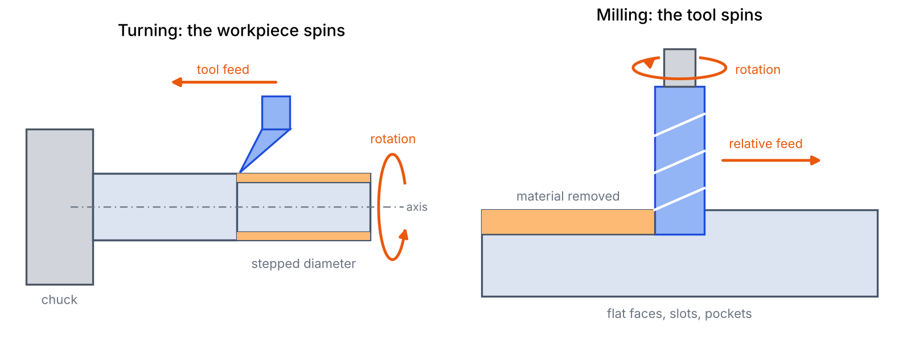
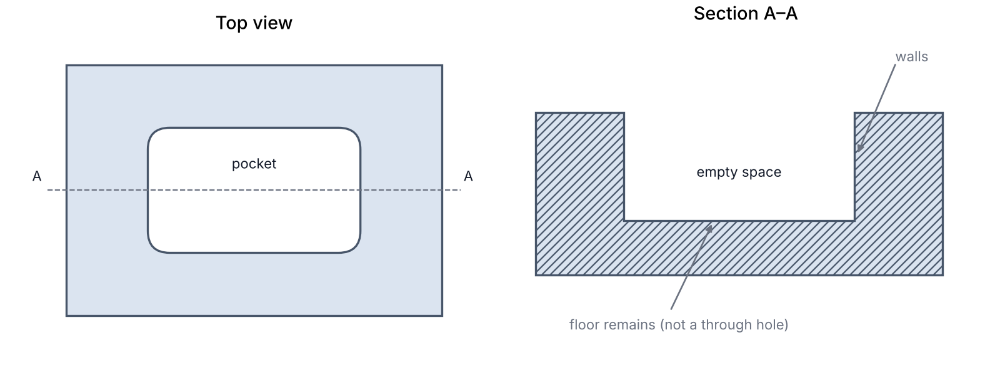
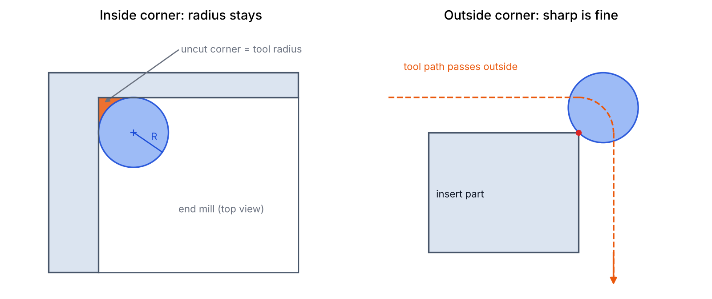
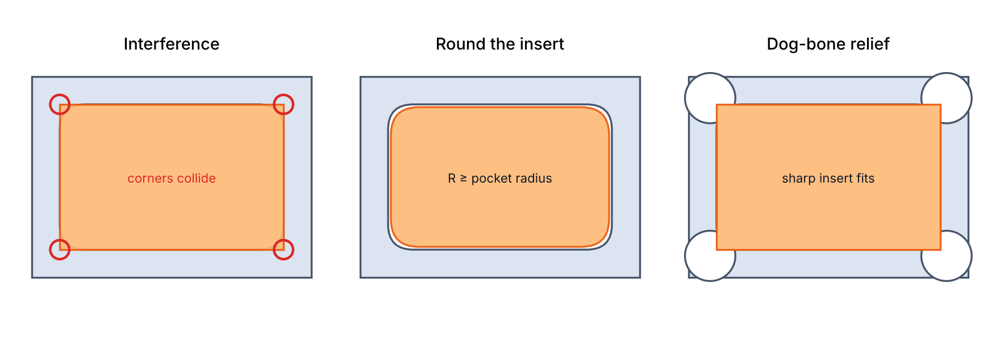
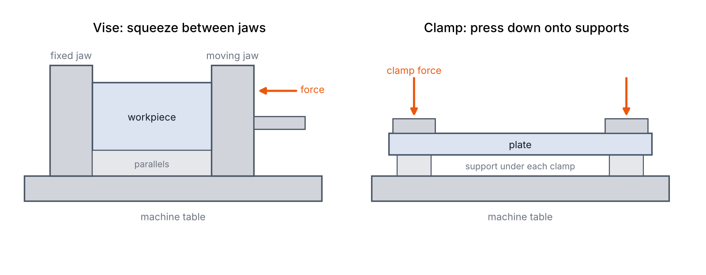
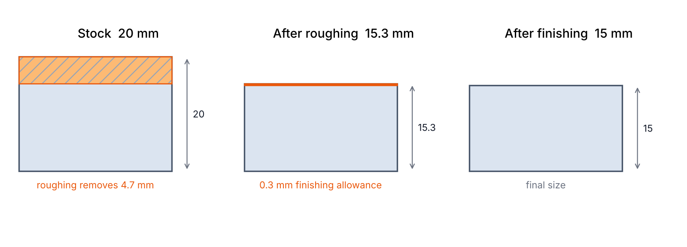
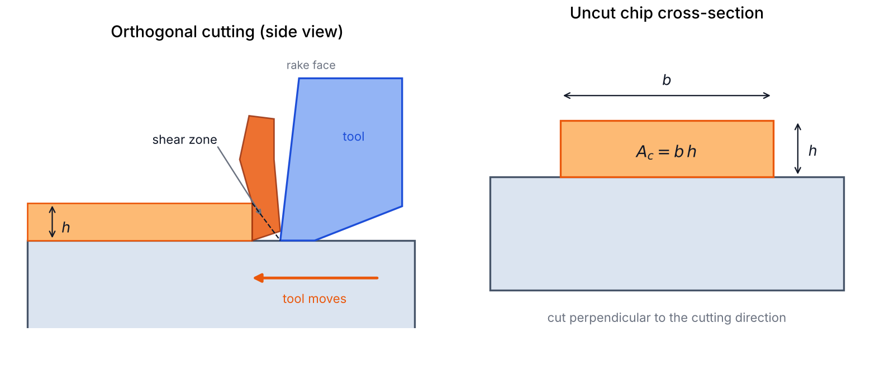
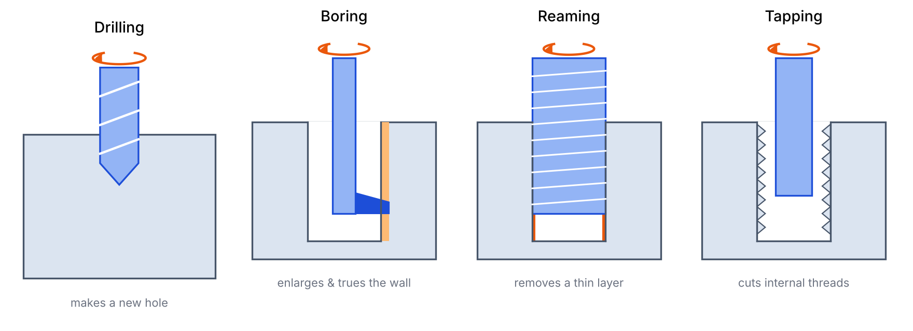

## 들어가며

절삭가공(Machining)은 공구로 소재의 일부를 제거해 원하는 형상과 치수를 만드는 방법이다. 제거되어 나온 조각을 **칩(Chip)**, 가공 대상인 재료나 부품을 **공작물**(Workpiece)이라고 한다. 제작법은 절삭뿐 아니라 주조, 성형, 접합, 적층제조 등을 포함하는 더 넓은 개념이다.

도면을 실제 부품으로 구현하려면 공법 이름만 아는 것으로는 부족하다. **공구가 어느 방향으로 접근하는지, 재료를 어떻게 고정하는지, 가공 후 조립이 가능한지**를 함께 판단해야 한다. 이 글은 그 판단에 필요한 절삭가공의 첫 번째 개관이다.

그림은 모두 개념 설명도이며 실제 장비의 구조·축척·절삭 조건을 재현하지 않는다. 색은 일관되게 쓴다. 회청색은 공작물, 파란색은 공구, 회색은 고정 장치, 주황색은 움직임이나 제거되는 재료를 나타낸다.

## 선반과 밀링 (Turning & Milling)

### 선반: 소재가 회전한다

선삭(Turning)에서는 척(Chuck)이 소재를 잡고 회전시키고, 절삭공구가 이동하며 소재를 깎는다. 이를 수행하는 공작기계가 선반(Lathe)이다. 원통의 바깥지름을 줄이거나, 구간별로 지름이 다른 단차축을 만드는 데 적합하다. 모터축이라면 소재를 고정하고, 회전축을 기준으로 바깥면을 깎고, 필요한 구간에 단차와 홈을 만든다.

### 밀링: 공구가 회전한다

밀링(Milling)은 여러 절삭날이 있는 공구를 회전시키면서 소재와 공구를 상대 이동시켜 깎는 가공이다. 장비 구조에 따라 테이블, 공구 또는 양쪽이 움직인다. 평면, 홈, 포켓, 브래킷의 외형 등 다양한 형상을 만들 수 있다.

| 구분 | 선반 | 밀링 |
|---|---|---|
| 회전하는 것 | 공작물 | 공구 |
| 대표 형상 | 원통, 단차, 원뿔, 나사 | 평면, 홈, 포켓, 복잡한 외형 |
| 부품 예 | 축, 핀, 부시 | 하우징, 브래킷, 플레이트 |

하나의 부품에 여러 공법을 쓸 수 있다. 축의 원통과 단차는 선삭하고, 축 옆면의 키홈은 밀링으로 가공하는 식이다. 복합가공기는 한 장비에서 두 작업을 모두 수행하기도 한다.

### CNC는 가공법이 아니라 제어 방식이다

**CNC(Computer Numerical Control)는 기계의 움직임을 컴퓨터로 수치 제어하는 방식**이다. 선반·밀링과 나란히 놓이는 별도의 제거 원리가 아니다. 수동으로 조작하는 범용 선반과 CNC 선반이 있고, 밀링 역시 수동 또는 CNC로 제어할 수 있다.

따라서 "CNC가 있다"는 말만으로 가공 가능한 소재와 형상을 판단할 수 없다. CNC 선반인지, 밀링인지, 라우터인지와 장비 사양을 함께 확인해야 한다. 밀링 머시닝센터는 일반적으로 자동 공구 교환 기능 등을 갖추어 여러 가공을 연속 수행한다.

## 포켓과 안쪽 모서리

### 포켓이란

포켓(Pocket)은 부품에 오목하게 파인 공간이다. 바닥이 남아 있다는 점에서 소재 두께 전체를 통과하는 관통 구멍과 구분한다. 이제 포켓에 별도의 사각형 부품을 끼워 넣는 상황을 생각해 보자.

### 안쪽 직각은 왜 만들 수 없는가

원통형 엔드밀(End mill)로 포켓의 수직 벽을 가공하면, 위에서 보았을 때 안쪽 모서리에 **공구 반지름만큼의 둥근 모서리**가 남는다. 공구가 꼭짓점까지 더 들어가면 남겨야 할 옆 벽을 깎아버리기 때문이다. 작은 공구로 반지름을 줄일 수는 있지만, 유한한 반지름을 가진 공구로 완전한 안쪽 직각은 만들 수 없다.

반면 사각형 부품의 **바깥쪽 윤곽**은 직각으로 만들 수 있다. 공구 중심이 부품 밖에서 꼭짓점을 돌아 지나갈 수 있기 때문이다. 원형 공구라는 사실만으로 모든 모서리가 둥글어지는 것은 아니다.

이는 일반적인 엔드밀로 수직 벽을 가공하는 경우의 이야기다. 안쪽 직각이 꼭 필요하면 방전가공 등 다른 공법을 검토해야 하며, 이후 글에서 다룬다.

### 조립 간섭을 해결하는 두 방향

포켓에 직각 꼭짓점을 가진 판을 끼우면, 안쪽 모서리에 남은 재료와 판의 꼭짓점이 간섭한다. 해결 방향은 두 가지다.

1. **삽입 부품 수정:** 바깥 꼭짓점을 라운드(Round) 또는 모따기(Chamfer)로 제거한다.
2. **포켓 수정:** 꼭짓점 주변을 추가로 파서 꼭짓점이 들어갈 공간을 만든다. 도그본(Dog-bone) 릴리프가 한 예다.

도그본의 위치·크기는 삽입 부품의 꼭짓점이 닿지 않도록 정한다. 부품의 라운드 역시 원형 엔드밀을 쓴다고 저절로 생기는 것이 아니라, 바깥 윤곽을 따라 공구 경로를 만들어 가공한다. 실제 조립에서는 형상뿐 아니라 치수공차와 조립 여유도 함께 검토한다.

## 공작물 고정 (Workholding)

공구가 소재를 깎으면 공작물에도 힘이 작용한다. 공작물이 움직이면 치수 오차가 생기고, 고정이 풀리면 위험하다. 가공 전에는 소재의 위치를 정하고, 받치고, 절삭력을 견디도록 고정해야 한다.

| 장치 | 고정 구조 | 대표 사용 |
|---|---|---|
| 바이스(Vise) | 고정 턱과 이동 턱 사이에 공작물을 물린다 | 평행한 면이 있는 블록 |
| 클램프(Clamp) | 공작물을 테이블·받침·고정구 쪽으로 누른다 | 넓은 판, 크거나 불규칙한 부품 |

바이스도 보통 공작기계 테이블에 고정한다. "테이블 위에서는 클램프, 공중에서는 바이스"로 구분하지 않는다. 바이스 역시 넓은 의미의 클램핑 장치이며, 고정력의 크기는 장치의 구조와 크기에 따라 달라진다.

### 세게 고정할수록 좋은가

고정력은 충분해야 하지만, 그 힘 때문에 부품이 변형되어서는 안 된다. 얇은 판을 길이 방향으로 압축하면 가운데가 휘는 좌굴이 생길 수 있고, 받침이 없는 곳을 클램프로 누르면 판이 휜다. 클램프 바로 아래에 받침을 두는 이유다. 접촉 부위만 눌리는 국부 변형과는 구분한다.

탄성적으로 휜 상태에서 윗면을 평평하게 가공해도, 고정을 풀면 복원되면서 윗면이 더 이상 평평하지 않을 수 있다. 모든 판이 바이스에서 휘는 것은 아니므로 형상, 고정 방향, 고정력, 받침 위치를 함께 본다.

## 황삭과 정삭 (Roughing & Finishing)

황삭(Roughing)은 불필요한 재료를 효율적으로 제거하는 단계이고, 정삭(Finishing)은 최종 치수·형상·표면 상태를 맞추는 단계이다. 황삭 후에는 정삭에서 제거할 소량의 재료, 즉 **정삭 여유**를 남긴다.

두께 20 mm 소재의 한쪽 면을 깎아 15 mm로 만든다면, 황삭으로 15.3 mm까지 가공한 뒤 남은 0.3 mm를 정삭할 수 있다. 개념 설명용 수치이며 실제 여유는 재료·형상·공정에 따라 정한다. 황삭과 정삭은 각각 여러 번의 공구 통과로 이루어질 수 있다.

나누는 이유는 두 요구가 충돌하기 때문이다.

- **처음부터 조금씩만 깎으면** 가공 시간이 길어져 생산성이 떨어진다.
- **많이 깎는 조건으로 최종 치수까지 가면** 절삭력·변형·진동을 관리하기 어려워 치수와 표면이 나빠질 수 있다.

다만 황삭만으로 요구 공차를 만족하는 경우도 있으므로 정삭이 모든 부품에 필수인 것은 아니다. "정삭하듯 가공하면 전력을 반드시 더 쓴다"는 단정도 피한다. 총에너지는 순간 소비전력과 전체 가공 시간을 함께 봐야 한다.

## 절삭력 (Cutting Force)

### 칩은 어떻게 만들어지는가

절삭력은 가공 중 공구와 공작물 사이에 작용하는 힘이다. 연성 금속을 절삭하면 공구 앞쪽 재료가 크게 소성변형되며, 주로 전단변형을 통해 칩이 형성된다. 칩은 공구의 경사면(Rake face)을 따라 흘러나간다. 항복은 영구 변형의 시작일 뿐 곧바로 재료가 분리된다는 뜻은 아니다.

공구와 소재가 서로 반대 방향의 힘을 받는 것은 작용·반작용이지만, 이것만으로 칩 형성이 설명되지는 않는다. 일반적인 금속 절삭에서 큰 힘이 필요한 주된 이유는 칩의 질량을 가속하는 관성보다 **재료를 소성변형시키는 저항과 공구 접촉면의 마찰**이다.

### 어떤 단면적이 중요한가

단순 직교절삭 모델에서 깎이기 전 칩의 폭을 $b$, 두께를 $h$라 하면, 미변형 칩 단면적(Uncut chip area)과 주절삭력은 다음과 같다.

$$
A_c = bh, \qquad F_c \approx k_c A_c
$$

$k_c$는 비절삭저항(Specific cutting force)이다. 재료뿐 아니라 칩 두께, 공구 형상, 가공 조건의 영향을 받으므로 고정된 재료 상수로 취급하지 않는다. 위 식은 경향을 이해하기 위한 근사식이다.

여기서 면적은 **절삭 후 드러난 표면적이 아니라, 공구 진행 방향에 수직으로 자른 제거 재료의 단면적**이다. 다른 조건이 비슷하면 이 단면적이 클수록 변형시킬 재료가 많아져 절삭력이 커진다. 밀링에서는 날의 위치에 따라 칩 두께와 힘이 계속 변하므로, 이 단순 모델을 그대로 장비 설정값으로 쓰지 않는다.

### 마찰과 속도

칩이 경사면을 누르면서 미끄러지므로 마찰이 그 상대 운동을 방해하고, 절삭을 계속하려면 이 저항에도 에너지를 공급해야 한다. 천천히 깎아도 마찰은 존재한다. 같은 마찰력이라면 마찰에 소비되는 동력은 상대 속도에 비례한다.

$$
P_{\mathrm{friction}} = F_{\mathrm{friction}}\, v_{\mathrm{relative}}
$$

실제 절삭에서는 속도에 따라 온도와 접촉 상태가 달라지므로, 빠르게 깎을수록 마찰력 자체가 반드시 커지는 것은 아니다.

### 절삭력이 치수에 미치는 영향

절삭력이 커지면 공구나 공작물이 휘고 진동이 생길 수 있다. 그 결과 명령한 공구 위치와 실제 날끝 위치가 달라져 치수 오차와 표면 품질 저하로 이어진다. 부품이 도면과 다르게 나왔다면 설계 치수를 바꾸기보다 측정, 공구, 고정, 가공 조건, 보정 상태부터 확인한다.

## 구멍 가공 (Hole Making)

| 공법 | 하는 일 | 대표 목적 |
|---|---|---|
| 드릴링(Drilling) | 재료에 구멍을 만든다 | 볼트 통과 구멍, 후속 가공용 기초 구멍 |
| 보링(Boring) | 기존 구멍의 안쪽을 절삭한다 | 지름·형상·축 위치의 수정 및 정밀 가공 |
| 리밍(Reaming) | 기존 구멍에서 소량을 제거한다 | 구멍 지름과 표면의 정밀 마무리 |
| 탭 가공(Tapping) | 구멍 안쪽에 나사산을 만든다 | 볼트를 직접 체결하는 암나사 |
| 연삭(Grinding) | 숫돌의 미세한 입자로 깎는다 | 축·평면 등의 정밀 마무리 |

드릴링·리밍·탭 가공은 드릴프레스나 머시닝센터 등에서 수행한다. 보링은 선반이나 밀링 계열 장비에서 수행하며, 어느 쪽이 회전하는지는 장비 구성에 따라 다르다.

리밍은 기존 구멍을 따라가는 경향이 있어 잘못 뚫린 구멍의 위치를 크게 바로잡지 못한다. 보링은 적절한 기준과 장비 설정으로 구멍의 축 위치를 수정할 수 있지만, 수정할 만큼의 재료가 남아 있어야 한다.

### 목적별 가공 순서

| 목적 | 대표 순서 |
|---|---|
| 볼트 통과 구멍 | 드릴링 → 버 제거 |
| 볼트 직접 체결 구멍 | 기초 구멍 드릴링 → (입구 모따기) → 탭 가공 → 검사 |
| 위치 결정 핀용 정밀 구멍 | 드릴링 → (보링) → 리밍 → 검사 |
| 정밀한 축 | 선삭 → (열처리) → 연삭 → 검사 |

괄호는 필요할 때만 하는 단계다. 버(Burr)는 가공 후 가장자리에 남는 얇고 날카로운 돌출물로, 조립이나 측정을 방해하므로 제거한다. 모든 부품이 같은 순서를 따르지는 않는다.

## 실습에서 관찰할 것

첫 실습은 단순한 플레이트나 브래킷으로 아래 흐름을 한 번 연결해 보는 것이 좋다.

**도면 → 고정 → 황삭 → 정삭 → 구멍 가공 → 버 제거 → 측정 → 조립**

공구가 지나가는 길뿐 아니라, 고정 장치와 충돌하지 않는지, 가공 후 어느 면을 기준으로 측정하는지도 본다.

| 관찰 대상 | 확인할 질문 |
|---|---|
| 소재와 공구 | 어떤 재료이며 어떤 공구로 제거하는가? |
| 고정과 받침 | 절삭력을 어느 방향으로 받으며, 어디가 지지되는가? |
| 가공 순서 | 어떤 면을 먼저 만들고, 언제 뒤집어 다시 고정하는가? |
| 형상 제약 | 공구가 접근할 수 없는 곳이나 안쪽 반지름이 있는가? |
| 결과 | 도면 치수, 표면, 버, 실제 조립 상태는 어떤가? |

레이저와 워터젯은 주로 판재를 잘라 윤곽을 얻는 장비이고, 밀링은 깊이를 제어하며 포켓·단차 등을 가공할 수 있다. 가공 가능 범위는 장비 사양으로 확인한다. 처음 접하는 장비는 담당자의 교육과 감독 아래 사용하며, 이 글의 개념도를 장비 운전 절차로 쓰지 않는다.

## 정리

- 선반은 소재가, 밀링은 공구가 회전한다. CNC는 가공법이 아니라 제어 방식이다.
- 엔드밀로 만든 포켓의 안쪽 모서리에는 공구 반지름이 남는다. 바깥 직각은 가능하다.
- 고정은 움직임을 막으면서도 부품을 변형시키지 않아야 한다.
- 황삭은 빠른 재료 제거, 정삭은 최종 치수·형상·표면 확보가 목적이다.
- 절삭력은 미변형 칩 단면적, 소성변형, 마찰로 이해한다. 구멍은 목적에 맞게 공법을 조합한다.

## 참고 자료

그림은 본문 설명을 위해 직접 작성했다. 실제 장비·공구 사진과 세부 정보는 아래 자료에서 확인할 수 있다.

- [Sandvik Coromant — Specific cutting force](https://www.sandvik.coromant.com/es-es/knowledge/materials/specific-cutting-force): 비절삭저항과 칩 단면적의 관계.
- [Sandvik Coromant — Milling formulas and definitions](https://www.sandvik.coromant.com/en-gb/knowledge/machining-formulas-definitions/milling-formulas-definitions): 밀링의 칩 두께, 가공량과 동력 관련 정의.
- [Haas — Lathe Workholding](https://www.haascnc.com/haas-tooling/lathe_workholding.html): 실제 선반용 고정 장치의 형태.
- [Haas — Lathe Part Setup](https://legacy-aem.haascnc.com/service/online-operator-s-manuals/lathe-operator-s-manual/lathe---part-setup.html): 소재 고정과 공구·공작물 설정을 연결해서 보는 장비 매뉴얼.
