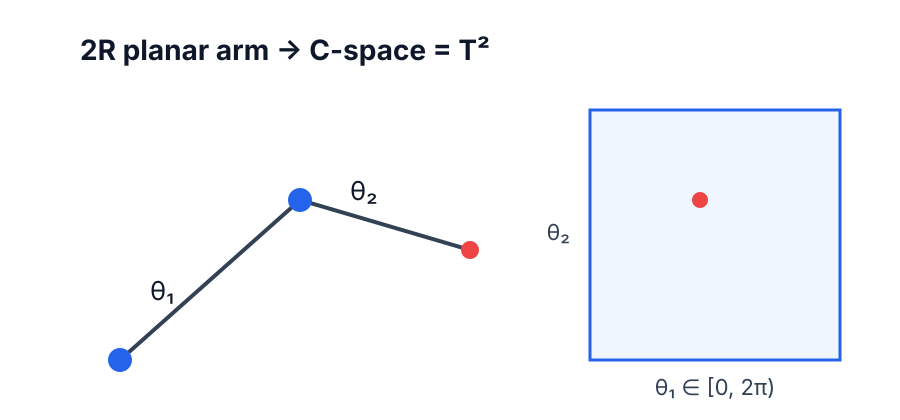

## 핵심 개념

로봇의 **configuration**은 로봇의 모든 점의 위치를 결정하는 최소한의 정보이고, 가능한 모든 configuration의 집합을 **configuration space(C-space)** 라고 한다. C-space의 차원이 곧 로봇의 **자유도(degrees of freedom, dof)** 이다.

## 자유도 계산: Grübler 공식

강체의 자유도를 $m$ (평면이면 $m=3$, 공간이면 $m=6$), 링크 수를 $N$ (지면 포함), 조인트 수를 $J$, 조인트 $i$의 자유도를 $f_i$ 라 하자.

### 유도

1. 지면을 제외한 $N-1$개의 링크는 구속이 없으면 각각 $m$의 자유도를 가진다.
2. 조인트 $i$는 두 링크 사이의 상대 운동을 $m - f_i$ 만큼 구속한다.
3. 구속이 서로 독립이라고 가정하면 남은 자유도는 다음과 같다.

$$
\text{dof} = m(N-1) - \sum_{i=1}^{J} (m - f_i) = m(N - 1 - J) + \sum_{i=1}^{J} f_i
$$

구속이 독립이 아닌 특이한 기구(예: 평행 링크)에서는 이 공식이 실제 자유도보다 작은 값을 줄 수 있다는 점에 주의한다.

## 예시: 2R 평면 로봇팔

두 개의 회전 조인트를 가진 평면 로봇팔은 $m=3$, $N=3$, $J=2$, $f_1=f_2=1$ 이므로

$$
\text{dof} = 3(3-1-2) + (1+1) = 2
$$

C-space는 두 관절각 $(\theta_1, \theta_2)$로 표현되며, 각 각도가 원 $S^1$ 위에 있으므로 위상적으로 토러스 $T^2 = S^1 \times S^1$ 이다.

## 정리

- 자유도 = C-space의 차원
- Grübler 공식: $\text{dof} = m(N-1-J) + \sum f_i$
- 같은 차원이라도 C-space의 **위상**(예: $\mathbb{R}^2$ vs $T^2$)은 다를 수 있다
